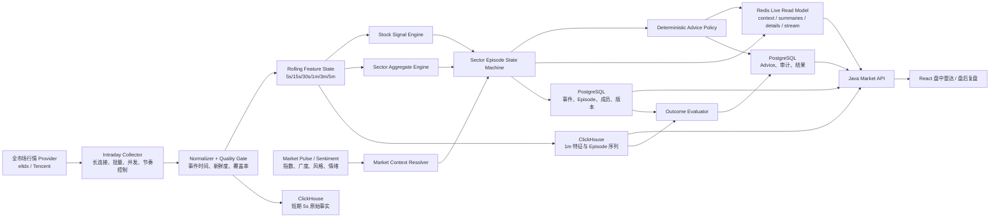

# Market Indicator（盘面传导）完整实现方案与执行计划

## 1. 最终结论

Market Indicator 不再继续作为“历史涨跌停池快照监控”，而应升级为 **盘面传导工作台**，同一套事实模型同时服务：

1. **盘中信号**：在目标 5 秒刷新节奏下，回答“什么环境、哪个板块、谁先动、谁跟随、是否形成真实扩散、现在处于什么阶段、有哪些买卖参考条件”。
2. **盘后复盘**：按事件发生时点回放当时可见的信息，评价 5/15/30 分钟及收盘结果，归纳有效传导、失败信号、核心股和次日关注清单。

实施顺序固定为：

```text
全市场 5 秒端到端基准门禁
  -> 指标契约与离线验证
  -> 利用现有数据重构工作流
  -> 建设真实板块传导引擎
  -> 盘后回放与结果评价
  -> 买卖参考、Agent 与可选 AI 解释
```

不能直接把当前 React 轮询从 60 秒改成 5 秒。当前生产链路仍是独立调度任务、历史涨跌停池、整包 Redis、延迟 PostgreSQL 落库和 `/latest` 大包查询；只改 UI 会以 5 秒频率重复读取旧数据，并放大 Redis 反序列化、Java 查询、网关与浏览器负担。

## 2. 已确认的产品与技术决策

### 2.1 刷新目标

- 第一目标是 **用户可见 5 秒刷新**。
- 先用全市场真实数据跑完整链路：

```text
Provider 拉取
  -> 标准化
  -> 数据质量判断
  -> 滚动特征
  -> 个股信号
  -> 板块聚合
  -> Episode 更新
  -> Redis 原子发布
  -> ClickHouse/PostgreSQL 异步持久化
  -> Java 查询
  -> Gateway/API
  -> UI 接收、解析、渲染
```

- 生产频率不凭感觉固定。根据 p50/p95/p99、覆盖率、行情新鲜度、提供方稳定性、CPU/内存、Redis/ClickHouse/PostgreSQL 压力、API 负载和浏览器渲染成本，从 5/10/15/30 秒中选择稳定档位。
- 页面始终显示 `目标频率`、`实际有效频率`、`最近成功发布`、`行情年龄`和`全市场覆盖率`，不把降频隐藏起来。

### 2.2 股票覆盖口径

- 默认尝试 **全市场扫描 + 完整行业成分股确认**。
- 历史涨跌停池保留为 `priority cohort`，用于：
  - 高关注候选优先计算；
  - 提供方或系统降级时的高频子集；
  - 与普通股票对照信号质量。
- 自选股、已活跃股票和当前 Episode 成员同样属于优先队列。
- 如果某次采集只能覆盖优先池，结果必须标注“池内线索”，禁止显示“板块高可信传导”。

### 2.3 买卖参考边界

- 系统提供有条件的辅助参考，不只提供“观察清单”。
- 第一版可输出：`等待确认`、`低仓位试探参考`、`回踩确认后关注`、`持有观察`、`不追高/规避`、`减仓参考`、`失效退出参考`。
- 每条参考必须同时包含：适用对象、适用持仓状态、触发条件、失效条件、风险区间、预期观察周期、证据、置信度、数据质量和生成时间。
- 不输出无条件“立即买入/卖出”，不接券商，不自动下单，不由大模型自行决定动作。
- 定量规则是唯一事实源；AI 如后续接入，只能解释、摘要和提示反证，不能修改动作、价格、置信度或失效条件。

## 3. 当前实现基线与必须解决的问题

### 3.1 当前真实链路

```text
Core Scheduler（当前通常分钟级判断）
  -> Data Executor 同步触发 market_indicator_refresh
  -> PostgreSQL 读取全股票元数据
  -> 过滤最近 365 天历史涨跌停股票池
  -> eltdx 按 batch_size=80 顺序拉取
  -> 标准化报价
  -> 从 Redis/PG 读取上一快照
  -> 按相邻快照日涨跌幅差识别 rapid event
  -> 聚合池内行业快照
  -> Redis 发布完整 JSON bundle
  -> 超过 180 秒的 bundle 每次最多刷一个到 PostgreSQL
  -> Java 从 Redis 整包反序列化或 PG 回退
  -> `/api/market/indicator/latest`
  -> UI 请求最多 2500 行，每 60 秒轮询
```

### 3.2 当前链路不适合全市场 5 秒的原因

1. Core Scheduler 默认 30 秒 tick，`every_minutes` 只支持分钟间隔；即使 cron 写 5 秒，也会受全局 30 秒扫描限制。
2. `market_indicator_refresh` 当前不是异步长驻任务；每次触发都创建连接、读取元数据、筛选股票并执行完整作业。
3. JobRunner 默认锁租约为 3600 秒，不适合无续租的全天长循环。
4. 当前 eltdx indicator 使用 80 只一批的顺序循环；全市场约 5500 只意味着约 69 批，需要实测并发和长连接能力。
5. 当前 Redis 每次保存全量股票、事件、行业和候选池的完整 JSON；5 秒全市场整包会产生高序列化、网络、内存和 Java 反序列化成本。
6. 当前 PostgreSQL 快照模型若保存全市场每 5 秒一行，约为：
   - 约 5500 只 × 2880 个交易时段采样点 ≈ 1584 万行/交易日；
   - 不适合继续以事务内逐行 UPSERT 的方式承载。
7. 当前 event 以“分钟”去重，会吞掉秒级阶段变化，也无法表达 Episode 生命周期。
8. 当前 Market Pulse 和 Market Sentiment 主要是日级/分钟级快照，缺少事件时刻的统一 `as-of` 上下文。

因此，5 秒目标需要改为 **长连接采集循环 + 内存滚动计算 + Redis 轻量发布 + ClickHouse 高频事实 + PostgreSQL 业务事件**，不能继续放大当前整包任务。

### 3.3 竞品能力如何落到实现

| 竞品模式 | Cynexus 实现落点 |
|---|---|
| 开盘啦的竞价—盘中—复盘连续路径 | 同一 `MarketContext -> SignalEvent -> SectorEpisode -> Outcome` 模型、盘中雷达/盘后复盘双模式、核心股与失败信号日结 |
| 同花顺的异动提醒 + 大盘背景 | 每个 signal/Episode 绑定事件时刻 MarketContext；列表按新鲜度、可信度和阶段排序，避免无优先级提醒洪水 |
| 东方财富的板块涨幅、资金、领涨股同排 | Episode 摘要行同时展示板块表现、资金/成交、当前领涨、先行候选、完整成分股响应；明确区分“当前领涨”和“带头线索” |
| 通达信的快速筛选和下钻 | 方向、阶段、置信度、自选、最新事件过滤；板块 -> Episode -> 成员/个股详情的短路径；公式编辑器不进入第一版 |
| 财联社的时间化催化解释 | CatalystEvidence 与行情证据并列，保留发布时间、来源、匹配置信度，不把新闻匹配写成确定因果 |
| TradingView 的 Bar Replay | `replay?at=` 严格 as-of 截断，时间轴拖动、同步图和“当时事实/后来结果”分区 |

竞品只提供工作流启示。Cynexus 的差异点是：传导结论必须能展开时间领先、相对强度、成交确认、完整成分股跟随、去 leader 持续和数据质量证据。

## 4. 目标架构



### 4.1 领域所有权

- **Market Pulse / Market Sentiment**：负责全市场指数、广度、成交、资金、风格和情绪事实。
- **Market Indicator / 盘面传导**：负责个股异动、板块传导 Episode、角色、传播梯队、结果与参考动作。
- **Python domain**：负责指标计算、Episode 状态机、数据质量、结果评价和定量参考规则。
- **Java domain**：负责查询边界、过滤、权限、DTO 组合、关注清单写入策略和对 Agent 暴露的治理；不复制 Python 算法。
- **AI domain**：只在明确启用时解释既有结构化结论，不拥有交易参考决策权。

## 5. Gate 0：全市场 5 秒端到端基准

这是所有后续实现的第一门禁。先建立可重复的 benchmark harness，再决定正式采集频率和主 Provider。

### 5.1 基准对象

| 层级 | 必测内容 |
|---|---|
| Provider | 建连、代码表、分批请求、解码、提供方时间戳、返回覆盖率、错误率 |
| Python | 标准化、质量判断、滚动窗口、个股特征、板块聚合、Episode、序列化 |
| Redis | 最新状态发布、版本切换、Stream 追加、读取延迟、内存增长 |
| ClickHouse | 5 秒批量写入、1 分钟聚合、队列积压、压缩率、查询延迟 |
| PostgreSQL | Episode/成员/结果批量写入，不测全市场逐行快照作为目标方案 |
| Java | Redis read model、Episode 详情、回放查询、JSON 序列化 |
| Gateway/API | 网络、压缩、响应体大小、并发 1/5/20 用户 |
| React | 请求、JSON parse、状态 diff、表格提交、图表更新、内存稳定性 |

### 5.2 数据规模矩阵

每组均使用真实活跃证券元数据，至少测试：

- 500：优先池快速烟测。
- 1500：中等覆盖。
- 3000：大范围覆盖。
- 全市场：以测试日实际 active universe 为准，预期约 5300–5600。

对全市场同时记录：可交易数、停牌数、无效价格数、提供方返回数、提供方时间戳新鲜数和行业映射数。

### 5.3 Provider 参数矩阵

#### eltdx

- `batch_size`: 80 / 160 / 320 / provider 支持的整包模式。
- `pool_size`: 4 / 8 / 16 / 32。
- `max_in_flight`: 1 / 2 / 4 / 8。
- 冷连接与连接复用分别测试。
- 验证 `get_quote(all_codes)` 是否由库内部高效分批，不能仅依据 API 形态推断性能。

#### Tencent qt

- `batch_size`: 200 / 500 / 800。
- `batch_sleep_ms`: 0 / 100 / 220。
- `max_in_flight`: 1 / 2 / 4。
- 检查 URL 长度、HTTP 状态、返回行数、GB18030 解码和 quote_time 新鲜度。

#### EastMoney / AkShare

- 只作为全市场广度校验、低频备援和来源差异对照。
- 当前 EastMoney 分页和 AkShare 重试模型不应预设为 5 秒主行情源；除非基准证明可稳定满足 SLO。

### 5.4 场景矩阵

1. 冷启动首轮。
2. 长连接预热后 30 轮。
3. 连续 600 轮 5 秒 soak（约 50 分钟）。
4. 至少一个 2 小时交易时段稳定性测试。
5. 09:30–09:40 高波动窗口。
6. 11:25–11:30、13:00–13:05、14:50–15:00。
7. 单 Provider 超时、部分批次缺失、Redis 短暂不可用、ClickHouse 写入变慢、Java API 重启后的恢复。

### 5.5 每轮计时字段

每个 capture 使用统一 `captureId` 和 `traceId`，记录：

- `scheduledAt`
- `fetchStartedAt`, `fetchCompletedAt`
- `normalizeCompletedAt`
- `qualityCompletedAt`
- `featureCompletedAt`
- `signalCompletedAt`
- `sectorCompletedAt`
- `episodeCompletedAt`
- `redisPublishedAt`
- `clickhouseEnqueuedAt`, `clickhouseCommittedAt`
- `javaReadStartedAt`, `javaResponseAt`
- `browserReceivedAt`, `browserCommittedAt`

核心时延：

```text
providerLatency = fetchCompletedAt - fetchStartedAt
computeLatency = episodeCompletedAt - fetchCompletedAt
publishLatency = redisPublishedAt - episodeCompletedAt
apiLatency = javaResponseAt - javaReadStartedAt
renderLatency = browserCommittedAt - browserReceivedAt
endToEndLatency = browserCommittedAt - fetchStartedAt
dataAge = browserCommittedAt - providerQuoteTimeP50/P95
```

### 5.6 5 秒生产 SLO 门禁

| 指标 | 5 秒档通过条件 |
|---|---|
| 全市场有效覆盖 | 每轮 ≥ 98.5%，连续 5 分钟不低于 98.0% |
| 行情新鲜覆盖 | ≥ 97% 股票的 provider quote time 年龄 ≤ 10 秒 |
| E2E p50 | ≤ 2.5 秒 |
| E2E p95 | ≤ 4.0 秒 |
| E2E p99 | ≤ 5.0 秒 |
| 周期超时 | `<1%` 轮次超过 5 秒，且不连续积压 2 轮 |
| Provider 失败 | `<0.5%` 批次失败；失败批次有重试/降级记录 |
| Redis publish p95 | ≤ 50 ms |
| Java live summary API p95 | ≤ 250 ms |
| Live summary 响应体 | gzip 后目标 ≤ 300 KB，不含全市场明细 |
| React 更新 p95 | ≤ 100 ms，长时间无明显 heap 持续增长 |
| CPU | 持续 p95 < 70%，无单核长期饱和 |
| ClickHouse 队列 | 正常不超过 2 个 capture；故障恢复后可追平 |

### 5.7 频率决策表

| 基准结果 | 生产策略 |
|---|---|
| p95 ≤ 4s 且 p99 ≤ 5s，全部质量门禁通过 | 全市场 5 秒 |
| 4s < p95 ≤ 8s | 全市场 10 秒；优先池/活跃 Episode 可尝试 5 秒 |
| 8s < p95 ≤ 12s | 全市场 15 秒；优先池 5 秒 |
| 12s < p95 ≤ 25s | 全市场 30 秒；优先池 5–10 秒 |
| p95 > 25s 或覆盖不稳定 | 停止全市场高频；全市场低频背景 + 优先池高频，并明确“池内确认” |

生产自适应降频必须有滞回：连续 6 轮超限才降档，连续 60 轮稳定才升档，防止 5/10 秒之间反复抖动。

## 6. 统一指标契约

### 6.1 全局约定

| 约定 | 定义 |
|---|---|
| 时间 | 存储与 API 使用带时区 UTC/ISO-8601；UI 按 Asia/Shanghai 展示 |
| 事件时间 | 优先使用 Provider quote time；本地采集时间不能冒充行情时间 |
| 百分比 | `returnPct`、`changePct` 使用百分点，如 1.25 表示 1.25% |
| 比率 | `coverageRatio`、`confidence` 使用 0–1 |
| 金额 | 原始存储使用人民币元；DTO 可额外提供格式化单位但不替代原值 |
| null | 表示来源缺失、窗口不足或质量无效；0 表示真实观测为零 |
| 精度 | 价格 Decimal(20,6)，百分比 Decimal(12,6)，内部计算 float/Decimal 后统一舍入 |
| 版本 | 每个对象带 `schemaVersion`、`algorithmVersion`、`thresholdSetId` |
| 来源 | 带 `provider`、`sourceTimestamp`、`captureId`、`inputVersion`、`membershipSnapshotDate` |
| 客户端兼容 | 新 enum 客户端按 unknown 处理，不能因新增枚举崩溃 |

### 6.2 DataQuality

所有事实对象都引用统一质量结构，质量与信号置信度分开。

| 字段 | 类型 | 含义 |
|---|---|---|
| `grade` | enum A/B/C/D | A 可用于建议；B 可展示；C 仅线索；D 禁止发布信号 |
| `coverageRatio` | decimal 0–1 | 有效返回 / eligible universe |
| `freshRatio` | decimal 0–1 | 新鲜报价 / 有效返回 |
| `staleRatio` | decimal 0–1 | 超过当前 freshness 阈值的比例 |
| `missingFieldRatio` | decimal 0–1 | 关键字段缺失比例 |
| `mappedIndustryRatio` | decimal 0–1 | 有行业映射的有效股票比例 |
| `providerErrorCount` | int | 本轮失败批次数 |
| `providerDivergencePct` | nullable decimal | 双源抽样价格差异 |
| `maxDataAgeMs` | long | 最旧有效数据年龄 |
| `warnings` | string[] | 可解释的降级原因 |

初始质量规则：

- A：coverage ≥ 98.5%、fresh ≥ 97%、行业映射 ≥ 97%、无严重来源分歧。
- B：coverage ≥ 95%、fresh ≥ 92%。
- C：coverage ≥ 80%，只能输出低置信线索。
- D：coverage < 80% 或关键时间戳不可用；不生成新 Episode/Advice。

阈值进入配置版本，最终由 Gate 0 和 shadow 数据校准。

### 6.3 ConfidenceEvidence

| 字段 | 类型 | 含义 |
|---|---|---|
| `score` | decimal 0–1 | 归一化置信度 |
| `level` | HIGH/MEDIUM/LOW/INSUFFICIENT | 展示级别 |
| `timingLead` | 0–1 | 时间领先证据 |
| `relativeStrength` | 0–1 | 相对板块/市场强度 |
| `activityConfirmation` | 0–1 | 成交额、成交量、换手确认 |
| `followerResponse` | 0–1 | 跟随覆盖与时延 |
| `exLeaderPersistence` | 0–1 | 去除候选后板块是否延续 |
| `marketCompatibility` | 0–1 | 大盘环境是否支持该方向 |
| `qualityPenalty` | 0–1 | 数据质量惩罚 |
| `reasons` | string[] | 人可读证据 |
| `counterEvidence` | string[] | 反证与不确定性 |

第一版权重建议：

```text
leaderConfidence =
  0.25 * timingLead
  + 0.20 * relativeStrength
  + 0.15 * activityConfirmation
  + 0.20 * followerResponse
  + 0.10 * exLeaderPersistence
  + 0.10 * marketCompatibility
  - qualityPenalty
```

权重必须由离线验证决定是否晋级；UI 必须同时展示组件，不能只展示总分。

### 6.4 MarketContextSnapshot

| 字段 | 类型 | 必填 | 说明 |
|---|---|---:|---|
| `contextId` | string | 是 | 稳定 ID |
| `tradeDate` | date | 是 | 交易日 |
| `bucketAt` | timestamp | 是 | 5 秒桶时间 |
| `asOf` | timestamp | 是 | 所有输入数据共同可见的截止时间 |
| `tradingPhase` | enum | 是 | PRE_OPEN/OPEN_SHOCK/MORNING/MIDDAY_BREAK/AFTERNOON/TAIL/CLOSED |
| `regime` | enum | 是 | BROAD_RISK_ON/BROAD_RISK_OFF/WEIGHT_LED/THEME_DIFFUSION/DIVERGENCE/LOW_LIQUIDITY/NEUTRAL/UNKNOWN |
| `regimeStrength` | 0–1 | 是 | 环境强度 |
| `indices` | array | 是 | 上证、沪深300、中证1000、创业板等 1/5/15 分钟和日内收益 |
| `breadth` | object | 是 | 全 A 上涨/下跌/平盘、涨跌停、阈值涨跌家数 |
| `liquidity` | object | 是 | 成交额、成交额速度、同时段基线比 |
| `sentiment` | object | 否 | MSI 综合值、关键分项和原始 as-of |
| `style` | object | 否 | 大/小盘、成长/价值、权重/题材相对强弱 |
| `activeEpisodeCount` | int | 是 | 当时活跃 Episode 数 |
| `dataQuality` | DataQuality | 是 | 环境质量 |
| `provenance` | object | 是 | Market Pulse/Sentiment 输入版本 |

环境规则初始候选：

- `BROAD_RISK_ON`：宽基 5 分钟同向上行、上涨家数比明显高于 50%、成交速度不弱。
- `BROAD_RISK_OFF`：宽基 5 分钟同向下行、下跌家数占优、亏钱效应扩散。
- `WEIGHT_LED`：沪深300显著强于中证1000，但广度未确认。
- `THEME_DIFFUSION`：小盘/题材显著强于权重，多个行业 Episode 扩散。
- `DIVERGENCE`：指数方向与市场广度、风格或成交不一致。
- `LOW_LIQUIDITY`：成交额速度低于同时段基线阈值。

这些是可配置规则，不作为未经验证的永久定义。

### 6.5 StockSignalEvent

| 字段 | 类型 | 说明 |
|---|---|---|
| `signalEventId` | string | 事件稳定 ID |
| `tradeDate` | date | 交易日 |
| `code`, `name`, `market` | string | 股票标识 |
| `industryCode`, `industryName` | string/null | 事件当时行业映射 |
| `membershipSnapshotDate` | date | 防止历史回放使用未来成分股 |
| `eventAt` | timestamp | 首次满足条件的 Provider 事件时间 |
| `detectedAt` | timestamp | 引擎检测时间 |
| `publishedAt` | timestamp | 对外可见时间 |
| `direction` | RISE/FALL | 方向 |
| `signalKind` | enum | RAPID_MOVE/SECTOR_RELATIVE_MOVE/ACTIVITY_BURST/LIMIT_TRANSITION/COMPOSITE |
| `windowSeconds` | 15/30/60/180/300 | 触发窗口 |
| `startPrice`, `lastPrice` | decimal | 窗口价格 |
| `returnPct` | decimal | 个股窗口收益 |
| `sectorReturnPct` | decimal | 板块稳健收益 |
| `sectorExcessPct` | decimal | 个股减板块 |
| `marketReturnPct` | decimal | 适配基准收益 |
| `marketExcessPct` | decimal | 个股减基准 |
| `amountVelocity` | decimal | 窗口增量成交额 / 交易秒 |
| `amountAcceleration` | decimal | 相对同时段历史基线倍数 |
| `volumeAcceleration` | decimal/null | 成交量加速 |
| `turnoverAcceleration` | decimal/null | 换手加速 |
| `limitTransition` | enum/null | NONE/TOUCH/SEAL/OPEN/RESEAL |
| `cohorts` | string[] | MARKET_ALL/HISTORICAL_LIMIT/WATCHLIST/ACTIVE_EPISODE |
| `thresholdSnapshot` | object | 当次阈值，便于复现 |
| `marketContextId` | string | 事件开始环境 |
| `confidence` | ConfidenceEvidence | 个股信号证据 |
| `dataQuality` | DataQuality | 数据质量 |
| `status` | OPEN/CONFIRMED/MERGED/EXPIRED | 生命周期 |
| `provenance` | object | Provider/capture/version |

幂等键建议：

```text
hash(schemaVersion, tradeDate, code, direction, signalKind,
     windowSeconds, firstTrigger5sBucket, algorithmVersion)
```

同股票、方向、信号类型和窗口处于 cooldown 时不重复创建，只更新峰值和证据；出现反向或 cooldown 后的新突破才创建新事件。

### 6.6 SectorEpisode

| 字段 | 类型 | 说明 |
|---|---|---|
| `episodeId` | string | 稳定 ID |
| `tradeDate` | date | 交易日 |
| `sectorType` | THS_INDUSTRY/CONCEPT | 第一阶段主口径 THS_INDUSTRY |
| `sectorCode`, `sectorName` | string | 板块标识 |
| `direction` | RISE/FALL | 拉升或打压 |
| `stage` | enum | EMERGING/CONFIRMED/SPREADING/CROWDED/DECAYING/FAILED/REVERSED/ENDED |
| `startedAt` | timestamp | 第一条合格先行信号 |
| `confirmedAt` | timestamp/null | 完整成分股达到确认条件 |
| `lastEvidenceAt` | timestamp | 最近证据更新时间 |
| `endedAt` | timestamp/null | 结束时间 |
| `marketContextAtStartId` | string | 开始环境 |
| `marketContextAtConfirmId` | string/null | 确认环境 |
| `eligibleCount` | int | 可参与确认的完整成分股数 |
| `observedCount` | int | 有新鲜报价数 |
| `respondedCount` | int | 已同向响应数 |
| `coverageRatio` | decimal | responded / eligible |
| `coveragePeak` | decimal | 生命周期峰值覆盖 |
| `medianLagSeconds`, `p75LagSeconds` | int/null | 跟随延迟 |
| `sectorEqualReturnPct` | decimal | 成分股等权收益 |
| `sectorMedianReturnPct` | decimal | 成分股稳健中位收益 |
| `exLeaderReturnPct` | decimal | 去候选带头股等权收益 |
| `weightedReturnPct` | decimal/null | 有可靠权重时的加权收益 |
| `benchmarkExcessPct` | decimal | 板块减市场基准 |
| `breadthDeltaPctPoint` | decimal | 方向性广度变化 |
| `amountAcceleration` | decimal/null | 板块成交额加速 |
| `leaderCandidates` | array | 排名、角色和证据 |
| `suppressorCandidates` | array | 下行压制候选 |
| `confidence` | ConfidenceEvidence | Episode 置信度 |
| `dataQuality` | DataQuality | 板块覆盖质量 |
| `failureReasons` | string[] | 未确认或失败原因 |
| `version` | long | 每次状态更新递增 |
| `provenance` | object | 输入事件与配置版本 |

Episode 聚合规则：

- 同一板块、同方向、相邻信号间隔不超过初始 `mergeGap=120s` 合并。
- 对向信号不合并；达到反转条件时关闭原 Episode 并创建关联反向 Episode。
- `EMERGING`：出现高质量先行信号，但完整板块未确认。
- `CONFIRMED`：在 `confirmWindow=180s` 内达到最小响应数、覆盖、去 leader 收益和广度条件。
- `SPREADING`：覆盖率和 follower arrival rate 仍上升。
- `CROWDED`：覆盖率、涨幅和成交拥挤达到高分位，提示追高风险，不等于更好的入场点。
- `DECAYING`：覆盖从峰值回落、去 leader 收益转弱或 follower arrival rate 接近零。
- `FAILED`：规定时间内无法确认，或确认后快速回撤到失效阈值。
- `ENDED`：连续一段时间无新证据且走势稳定结束。

初始确认条件不是永久阈值，而是离线校准起点：

```text
respondedCount >= max(3, ceil(eligibleCount * 0.15))
coverageRatio >= 0.15
direction * exLeaderReturnPct >= 0.30
direction * breadthDeltaPctPoint >= 10
medianLagSeconds <= 180
dataQuality.grade in {A, B}
```

### 6.7 EpisodeMemberResponse

| 字段 | 类型 | 说明 |
|---|---|---|
| `episodeId`, `code` | string | 归属 |
| `role` | enum | LEADER_CANDIDATE/EMOTIONAL_LEADER/WEIGHT_DRIVER/FIRST_WAVE/SECOND_WAVE/FOLLOWER/UNRESPONSIVE/OPPOSITE/SUSPENDED |
| `firstSignalEventId` | string/null | 首次响应信号 |
| `firstResponseAt` | timestamp/null | 首次同向响应时间 |
| `lagSeconds` | int/null | 相对 Episode startedAt 的交易秒 |
| `returnAtResponsePct` | decimal/null | 响应时收益 |
| `sectorExcessAtResponsePct` | decimal/null | 响应时板块超额 |
| `peakReturnPct` | decimal/null | Episode 期间峰值 |
| `closeReturnPct` | decimal/null | 收盘收益 |
| `contributionShare` | decimal/null | 加权贡献占比 |
| `activityAcceleration` | decimal/null | 成交确认 |
| `responseEvidence` | object | 达到响应的阈值 |
| `dataQuality` | DataQuality | 成员质量 |

成员响应条件建议采用相对阈值：

```text
direction * returnSinceEpisodeStart
  >= max(absReturnThreshold, sectorMADMultiplier * sectorReturnMAD)

且

direction * marketExcessPct >= minimumMarketExcess
```

使用 MAD/分位数避免小波动板块和高波动板块共用同一个绝对阈值。

### 6.8 EpisodeOutcome

| 字段 | 类型 | 说明 |
|---|---|---|
| `episodeId` | string | Episode |
| `anchorType` | START/CONFIRM | 结果锚点，正式评价优先 CONFIRM |
| `evaluatedAt` | timestamp | 评价时间 |
| `forwardSectorReturn5m/15m/30m/ClosePct` | decimal/null | 板块等权后续收益 |
| `forwardExcess5m/15m/30m/ClosePct` | decimal/null | 相对基准后续收益 |
| `leaderForwardReturn*` | decimal/null | 带头候选后续收益 |
| `exLeaderForwardReturn*` | decimal/null | 去 leader 后续收益 |
| `maxFavorableExcursionPct` | decimal | 最大有利变动 |
| `maxAdverseExcursionPct` | decimal | 最大不利变动 |
| `coveragePeak` | decimal | 峰值传播覆盖 |
| `persistenceTradingSeconds` | int | 有效持续交易秒 |
| `closeRetentionRatio` | decimal/null | 收盘保留 / 峰值强度 |
| `outcome` | enum | SUSTAINED/FADED/FAILED/REVERSED/LATE_SPREAD/UNRESOLVED |
| `failureReasons` | string[] | 大盘逆风、仅权重、成交不足、跟随不足、过晚等 |
| `quality` | DataQuality | 评价数据完整性 |
| `algorithmVersion` | string | 评价规则版本 |

5/15/30 分钟均按“交易秒”计算，跨午休时跳过休市时间，不能把午休 90 分钟算作信号持有时间。

### 6.9 TradeReferenceAdvice

| 字段 | 类型 | 说明 |
|---|---|---|
| `adviceId` | string | 稳定 ID |
| `episodeId` | string | 来源 Episode |
| `targetType` | STOCK/SECTOR | 对象 |
| `targetCode`, `targetName` | string | 标的 |
| `positionState` | NO_POSITION/HOLDING/BOTH | 适用状态 |
| `actionClass` | enum | 见下方动作集 |
| `generatedAt`, `asOf` | timestamp | 生成与事实截止时间 |
| `validUntil` | timestamp | 过期后必须重新评估 |
| `horizon` | INTRADAY/15M/30M/NEXT_DAY | 观察周期 |
| `confidence` | 0–1 | 参考置信度 |
| `entryConditions` | predicate[] | 入场/关注条件 |
| `invalidationConditions` | predicate[] | 失效条件 |
| `riskReference` | object | 风险价/区间、最大容忍回撤来源 |
| `rewardReference` | object | 前高/扩散目标/历史分位，仅作参考 |
| `marketCompatibility` | object | 大盘环境是否兼容 |
| `evidence` | string[] | 正向证据 |
| `counterEvidence` | string[] | 反证 |
| `disclaimerCode` | string | 固定披露版本 |
| `policyVersion` | string | 决策规则版本 |
| `dataQuality` | DataQuality | 建议质量门禁 |

动作集：

- `OBSERVE`：观察。
- `WAIT_CONFIRMATION`：等待板块或成交二次确认。
- `PROBE_REFERENCE`：低仓位试探参考；只能在全部门禁通过时出现。
- `PULLBACK_CONFIRMATION_REFERENCE`：回踩不破失效位且板块重新扩散后关注。
- `HOLD_OBSERVE`：已有持仓可继续观察，附失效条件。
- `DO_NOT_CHASE`：拥挤、延伸过大或风险收益不合理。
- `REDUCE_AVOID_REFERENCE`：减仓/规避参考。
- `INVALIDATION_EXIT_REFERENCE`：既定逻辑已失效的退出参考。

## 7. 核心计算规则

### 7.1 固定时间桶与窗口

- 将 Provider quote time 向下归入 5 秒桶；本地到达时间只用于测延迟。
- 一个桶内同股票多条报价取事件时间最新的一条。
- 窗口取 `t-w` 之前最近一条合格数据，允许容差不超过一个有效采样周期；超出则该窗口为 null。
- 交易中断、午休、停牌、累积成交额重置和 Provider 时间倒退必须显式处理。

### 7.2 收益与超额

```text
stockReturn(i,t,w) = 100 * (price(i,t) / price(i,t-w) - 1)
sectorMedianReturn(s,t,w) = median(stockReturn(j,t,w), j in eligible sector s)
sectorEqualReturn(s,t,w) = mean(winsorized stockReturn(j,t,w))
stockSectorExcess = stockReturn - sectorMedianReturn
stockMarketExcess = stockReturn - benchmarkReturn
exLeaderReturn = mean(stockReturn(j), j != leaderCandidate)
```

- `sectorMedianReturn` 用于稳健比较。
- `sectorEqualReturn` 用于表达整体表现。
- `weightedReturn` 用于指数贡献。
- 三者不可互相替代。

### 7.3 成交额与成交量速度

行情中的 amount/volume 通常是日内累计值：

```text
amountDelta = max(cumulativeAmount(t) - cumulativeAmount(t-w), 0)
amountVelocity = amountDelta / validTradingSeconds
amountAcceleration = amountVelocity / sameMinuteHistoricalMedianVelocity
```

- 同时段基线只使用事件日前的历史交易日。
- 基线不足时使用横截面行业中位数并降低质量等级。
- 复权或日切导致累计值回退时，窗口无效，不允许用负增量计算。

### 7.4 带头作用与角色

不能把“当前涨幅第一”直接叫带头股。角色判定至少看五类证据：

1. 时间领先：在板块稳健收益突破前先出现合格异常。
2. 相对强度：相对板块和基准有显著超额。
3. 活跃确认：成交额/量/换手同步加速。
4. 跟随响应：后续完整成分股同向响应，覆盖和延迟合理。
5. 去 leader 持续：去掉候选后板块仍有同向收益和广度。

初始角色规则：

- `EMOTIONAL_LEADER`：时间领先高、follower response 高、ex-leader persistence 为正。
- `WEIGHT_DRIVER`：加权贡献高，但等权覆盖或去 leader 表现弱。
- `INDEPENDENT_MOVE`：个股信号强，板块未在确认窗口内扩散。
- `SUPPRESSOR`：率先下行，随后板块广度和稳健收益恶化。
- `RESILIENT`：板块下行时逆势抗跌，作为结构线索，不算下行带头。

UI 文案使用“高可信带动线索”“领先并扩散”“疑似压制”，不声称已证明因果。

### 7.5 Episode 结束与反转

- 连续 `decayWindow` 无新增 follower，覆盖从峰值下降，且 ex-leader 强度回落，进入 DECAYING。
- 若板块超额回到启动前基线并持续两个采样周期，进入 FAILED/ENDED。
- 若相反方向达到确认阈值，原 Episode 标记 REVERSED，并通过 `reversedByEpisodeId` 关联新 Episode。
- 每次状态变化写入不可变 lifecycle event，避免盘后只能看到最终状态。

## 8. 指标契约与离线验证

### 8.1 数据准备分两层

当前没有足够的全市场真实 5 秒历史数据，因此不能直接声称完成 5 秒模型验证。

#### A. 1 分钟代理回放

- 使用已有/补齐的全市场 1 分钟 K 线、行业历史成分、宽基指数和日级情绪。
- 目标：验证“领先、扩散、去 leader、结果评价”的方向是否成立，淘汰明显无效的指标和阈值区间。
- 不能用于证明 5 秒 follower lag 或秒级成交加速有效。

#### B. 真实 5 秒 Shadow 数据

- Gate 0 通过后，连续采集至少 20 个交易日。
- 前 10 个交易日用于阈值校准，后 10 个交易日用于不改参数的 holdout。
- 建议至少覆盖：指数强涨、强跌、震荡、缩量、题材扩散和权重行情；如果 20 日未覆盖，则延长观察。

### 8.2 防未来数据泄漏

1. 行业成分使用事件交易日当时可得的 snapshot，不使用当前最新成分回填历史。
2. 同时段成交基线只使用事件日前数据。
3. Market Sentiment 使用 `asOf <= eventAt` 的版本；日终最终值不能回灌到 10:17。
4. Leader 选择只能使用确认时刻之前的信号。
5. Outcome 字段与输入特征物理/逻辑分离，实时引擎不可查询 outcome 表。
6. 时间切分，禁止随机打散 Episode。

### 8.3 数据切分

- Development：最早 60% 交易日，用于指标探索。
- Calibration：中间 20%，选择阈值和置信度映射。
- Holdout：最近 20%，参数冻结后只评估一次。
- 额外做按月 walk-forward，观察阈值漂移。
- 同一 Episode 的所有成员和结果必须在同一 split。

### 8.4 验证指标

#### Signal 层

- 每日信号数、每股票信号数、重复率、cooldown 合并率。
- 1/3/5 分钟窗口覆盖率。
- 信号后 3/5 分钟形成 Episode 的比例。
- 单股未扩散率、反向率、来源异常导致的误报率。

#### Episode 层

- Episode/日、确认率、确认耗时分布。
- follower coverage、median/p75 lag。
- 高/中/低 confidence 的结果单调性。
- `exLeaderReturn` 是否显著区别权重单股拉动与真实扩散。
- 阶段迁移合理性：EMERGING->CONFIRMED、CONFIRMED->FAILED 等分布。

#### Outcome 层

- 5/15/30 分钟及收盘方向命中率。
- forward sector excess 的均值、中位数、分位数和置信区间。
- MFE、MAE、close retention。
- SUSTAINED/FADED/FAILED/REVERSED 分类混淆情况。
- 按市场环境、时间段、板块规模、方向、Provider、数据质量切片。

#### Advice 层

- `PROBE_REFERENCE` 后 15/30 分钟正向超额概率。
- 扣除保守滑点/摩擦假设后的期望值，仅作规则评价，不模拟真实成交。
- MAE 是否落在风险参考区间内。
- `DO_NOT_CHASE` 是否有效识别高 MFE 后低 retention 的拥挤事件。
- `REDUCE/EXIT` 后回撤规避效果。
- confidence calibration/Brier score 和样本量。

### 8.5 晋级门禁

以下是第一版建议门槛，最终在数据审查会上确认：

| 能力 | 晋级要求 |
|---|---|
| Signal 可进入 shadow | 数据可复现率 100%；重复率受控；无未来泄漏 |
| Episode 对用户可见 | Holdout 中高置信 Episode 的 15 分钟方向正确率 ≥ 65%，且相对中置信至少高 10 个百分点 |
| “高可信带动”文案 | 高置信样本中完整成分股确认率 ≥ 70%，且 ex-leader persistence 为正的比例 ≥ 65% |
| 5 秒 live | Gate 0 全部 SLO + 连续 10 个交易日运行无严重质量事故 |
| `PROBE_REFERENCE` shadow | Holdout 样本 ≥ 100，15/30 分钟期望和风险收益均为正，置信区间不显示明显负优势 |
| 买卖参考对用户可见 | 再经过至少 10 个交易日 shadow；规则、反证和失效条件完整率 100% |

达不到门槛时只能降低文案级别或继续 shadow，不能通过调整 UI 文案掩盖指标无效。

## 9. 利用现有数据重构工作流

这一阶段先解决用户路径，不等待真实传导引擎全部完成，但所有临时语义必须诚实。

### 9.1 可直接复用的数据

- Market Pulse：全 A 广度、成交额、资金流、宽基指数、1 分钟指数 K、风格、行业当前领涨股和资金。
- Market Sentiment：综合分和九个分项。
- Market Indicator：历史涨跌停池、盘口涨跌停状态、池内快速事件、行业映射。
- THS 行业成分股与 TDX/THS 映射。

### 9.2 第一阶段页面

#### 盘中雷达

1. 顶部状态：交易阶段、最后数据、延迟、覆盖、实际刷新档位。
2. 大盘环境带：指数、广度、成交速度、情绪、风格结论。
3. 初级 Episode 列表：使用现有池内事件按行业和时间聚合，字段标记为：
   - “当前领涨股”；
   - “池内最早异动”；
   - “池内响应数”；
   - “完整板块确认暂不可用”。
4. 详情：当前个股、行业当前数据、Market Pulse 领涨/资金、事件时刻环境。
5. 原始股票事件流降级为详情证据，不再作为页面主结构。

#### 盘后复盘骨架

- 可选择日期。
- 展示当日池内事件簇和 Market Pulse/指数轨迹。
- 若还没有真实 outcome，只展示可计算结果并明确分辨率/覆盖，不生成高可信结论。

### 9.3 API 拆包

- 不再由一个 `/latest` 返回最多 2500 只股票。
- summary 只返回大盘环境和 Episode 摘要。
- 成员、分时、证据按选择的 Episode 懒加载。
- 保留旧 `/latest` 兼容 Market Overview，直到其消费者迁移完成。

### 9.4 阶段验收

- 用户打开页面 15 秒内能回答大盘环境和最新异动板块。
- 页面不再把池内统计误写为全市场/完整板块传导。
- 5 秒轮询只读取轻量 summary，前一次请求未完成时不发起重叠请求。
- 页面隐藏时降频，恢复可见时立即拉最新版本。

## 10. 真实板块传导引擎

### 10.1 采集运行方式

新增 `market_indicator_intraday_session` 长任务，由 Core Scheduler 在交易时段前触发一次，不再每 5 秒创建独立 job。

建议运行窗口：

- 09:20 启动并预热 Provider、元数据、行业映射和基线。
- 09:25–09:30 可采集但标记 PRE_OPEN，不与连续竞价信号混合。
- 09:30–11:30、13:00–15:00 正常循环。
- 午休保留状态，停止高频 Provider 调用或降频到 30–60 秒健康检查。
- 15:05 结束实时循环并触发 outcome finalize。

任务要求：

- 加入 async job 清单。
- 使用可续租的 Redis/PostgreSQL leader lease，至少每 10 秒续租；不能只依赖 JobRunner 3600 秒默认锁。
- 支持 graceful shutdown、重启恢复、checkpoint 和 kill switch。
- 每轮按照绝对时间计算下个 5 秒边界，避免 `sleep(5)` 累积漂移。
- 计算/写入超过目标周期时跳过过期计划点，不并发堆积同一 session 的 capture。

### 10.2 双层 Universe

```text
Tier 0: 当前活跃 Episode、Leader 候选、自选股
Tier 1: 历史涨跌停池
Tier 2: 其余全市场
```

- 5 秒全市场通过时，三层同频，只保留优先级用于重试和故障恢复。
- 降级时，Tier 0 可 5 秒、Tier 1 可 5–10 秒、Tier 2 按 15–30 秒。
- 完整板块确认必须基于每只成分股的 `asOf` 和新鲜度；混合频率时以最慢有效时间对齐，并降低置信度。

### 10.3 内存状态

引擎为每只股票保留最近 10 分钟环形缓冲：价格、累计量额、换手、limit 状态、quote time、质量。

板块保留：

- 5 秒稳健/等权/加权收益；
- ex-leader 快速重算所需的 sum/count 或可移除聚合；
- 广度、响应成员集合、arrival queue；
- 当前 Episode state 和峰值。

定期向 Redis 写恢复 checkpoint，但不把每个滚动点作为巨大 JSON 全量复制。

### 10.4 真实传导确认

一个 Episode 只有同时满足以下层次才升级：

1. 个股先行信号质量合格。
2. 同行业完整成分股覆盖达到门槛。
3. 去除候选后板块仍同向。
4. follower 数和 lag 达标。
5. 大盘/行业基准超额不是纯指数共振。
6. 数据质量允许该文案级别。

输出同时区分：

- 情绪扩散型带头；
- 权重指数贡献型；
- 成交/资金引导型；
- 独立异动；
- 下行压制；
- 逆势抗跌/抗涨。

### 10.5 催化证据

催化不是确认传导的必要条件，作为独立证据层：

- 输入：公告、财联社电报、东方财富新闻、题材标签等。
- 只匹配 `publishedAt <= replayAt` 的内容。
- 记录来源、发布时间、匹配方式和置信度。
- UI 分为“行情证据”和“可能催化”，不写成确定原因。

## 11. 盘后回放与结果评价

### 11.1 回放原则

- 回放时间点 `at=10:17:00` 时，只返回 `publishedAt <= at` 的 context、signal、Episode lifecycle 和 catalyst。
- Outcome 必须在单独区域标记“后来结果”，不能混入 10:17 的当时状态。
- 回放使用保存的 lifecycle event 或按当时版本重建，不能只用 Episode 最终行倒推。

### 11.2 回放数据层

- 全市场原始 5 秒报价只短期保存。
- Episode 相关板块和成员的 5 秒序列长期/中期保存，保证重点事件可复盘。
- 全市场 1 分钟特征保留更长时间，作为日期级回放和离线验证基础。
- 回放 API 根据日期跨度和缩放选择 5 秒或 1 分钟 resolution，并返回实际分辨率。

### 11.3 日终任务

`market_indicator_outcome_finalize` 在 15:05 后执行：

1. 找出当日全部 Episode。
2. 对 START 和 CONFIRM 两个锚点计算 5/15/30 分钟与收盘结果。
3. 计算 MFE/MAE、peak coverage、persistence、retention。
4. 按版本化规则写 outcome。
5. 生成日级摘要：最强传导、最强压制、有效/失败数、核心 leader、风险案例。
6. 生成 deterministic advice 的盘后/次日版本。
7. 发布 review version，供 Java/UI 查询。

任务必须可幂等重跑；行情补齐后允许以新 `evaluationVersion` 重评，历史版本保留或可审计。

### 11.4 复盘页面

- 当日环境轨迹：开盘、上午、午后、尾盘。
- 事件时间轴：大盘层、板块 Episode 层、股票信号层。
- Episode 成绩表：开始/确认、leader、覆盖、lag、5/15/30/close、MFE/MAE、结果和失败原因。
- 同步图：leader、板块等权、ex-leader、基准。
- 失败信号清单：仅权重、无量、逆风、跟随不足、过晚、来源质量差。
- 次日关注：保存股票/板块、来源 Episode、关注理由、失效条件和目标交易日。

## 12. 买卖参考规则

### 12.1 硬门禁

任何买卖参考出现前必须满足：

- Episode 不为低质量/池内-only。
- DataQuality 为 A 或 B。
- Advice 使用的所有行情 `asOf` 新鲜。
- 有完整 `entryConditions`、`invalidationConditions` 和 `riskReference`。
- 规则版本已通过离线和 shadow 门禁。
- 不是数据源分歧、午休冻结或系统降级状态。

### 12.2 初始决策表

| 条件 | 参考动作 |
|---|---|
| EMERGING、跟随不足或 confidence < 0.65 | WAIT_CONFIRMATION |
| CONFIRMED/SPREADING，confidence ≥ 0.75，coverage 达标，ex-leader 同向，环境兼容，未过度延伸，风险收益 ≥ 1.5 | PROBE_REFERENCE |
| 回踩 Episode 支撑/锚点未失效，覆盖重新上升 | PULLBACK_CONFIRMATION_REFERENCE |
| 已持仓，Episode 仍 CONFIRMED/SPREADING，失效条件未触发 | HOLD_OBSERVE |
| CROWDED、涨幅延伸分位过高、封板后流动性差或风险收益不足 | DO_NOT_CHASE |
| DECAYING，coverage 较峰值下降 ≥ 30%，ex-leader 走弱或环境转逆 | REDUCE_AVOID_REFERENCE |
| REVERSED/FAILED，或价格跌破失效位且板块确认同步消失 | INVALIDATION_EXIT_REFERENCE |

### 12.3 风险参考

- `invalidationPrice` 可来自 Episode 启动低点、最近有效 swing、板块确认时锚点或 VWAP 支撑；来源必须显示。
- 无可靠失效位时禁止输出 PROBE_REFERENCE。
- 第一版只输出定性仓位：`不参与/极轻/轻/持有/降低/退出参考`，不输出个性化资产比例。
- 风险收益比基于可解释目标和失效距离，不能由 AI 补写。
- Advice 有效期一般不超过 15 分钟或下一个阶段变化；过期自动降为“需重新评估”。

### 12.4 盘后次日参考

- `NEXT_DAY` 参考只针对 SUSTAINED/LATE_SPREAD 且催化、环境和 close retention 合格的 Episode。
- 必须提供次日观察条件，如竞价强弱、板块广度、leader 是否高开过度、关键失效位。
- 不把前一日结果直接延伸成次日无条件买入建议。

## 13. API 设计

### 13.1 Live

```text
GET /api/market/indicator/live/context
GET /api/market/indicator/live/episodes
GET /api/market/indicator/live/episodes/{episodeId}
GET /api/market/indicator/live/episodes/{episodeId}/series
GET /api/market/indicator/live/episodes/{episodeId}/advice
```

`live/episodes` 参数：

- `direction`, `stage`, `sectorType`, `minConfidence`
- `onlyNew`, `onlyWatchlist`, `qualityGrade`
- `afterVersion`：只返回变更摘要。
- `limit`：默认 50，最大 200。

响应公共字段：

```json
{
  "schemaVersion": 2,
  "dataVersion": 123456,
  "serverTime": "...",
  "publishedAt": "...",
  "effectiveCadenceSeconds": 5,
  "nextPollAfterMs": 5000,
  "unchanged": false,
  "quality": {},
  "items": []
}
```

### 13.2 Review / Replay

```text
GET /api/market/indicator/review?tradeDate=
GET /api/market/indicator/review/episodes?tradeDate=&outcome=&direction=
GET /api/market/indicator/replay?tradeDate=&at=&resolution=
GET /api/market/indicator/episodes/{episodeId}/outcome
```

- `replay` 强制按 `at` 截断事实。
- series 最大 1000 点；超过自动聚合。
- 返回 `resolutionUsed` 和 `truncated`。

### 13.3 Watchlist 写入

优先复用 self-selected list，扩展 `listKind=market_indicator_review`、item `sourceType=market_indicator`，并在 extra 中保存 episodeId、targetTradeDate、evidence 和 invalidation。

```text
POST /api/market/indicator/watchlist/preview
POST /api/market/indicator/watchlist/confirm
```

- 普通 UI 的确认按钮即显式确认，写入审计。
- Agent 调用必须 preview -> confirmation token -> confirm -> audit。

### 13.4 兼容接口

- `/latest` 在迁移期保留。
- Market Overview 改为只读取轻量兼容摘要，不再拉 250/2500 行全量明细。
- 兼容期结束前记录旧接口调用量，确认无消费者后再废弃。

## 14. 存储设计

### 14.1 Redis：只做实时 read model 与恢复状态

建议键：

```text
cynexus:market-transmission:{tradeDate}:latest-version
cynexus:market-transmission:{tradeDate}:context:{version}
cynexus:market-transmission:{tradeDate}:episode-summaries:{version}
cynexus:market-transmission:{tradeDate}:episode:{episodeId}:{version}
cynexus:market-transmission:{tradeDate}:updates      # capped stream
cynexus:market-transmission:{tradeDate}:checkpoint  # runtime recovery
cynexus:market-transmission:leader-lease
```

- 用 pipeline/Lua 先写 version 内容，再原子切换 latest-version。
- summary、detail 分开；不再每 5 秒复制全市场股票 JSON。
- 更新 Stream 保留有限长度，供增量 API/未来 SSE。
- live key TTL 2–3 个交易日；checkpoint 在 session 结束后缩短 TTL。

### 14.2 ClickHouse：高频事实和回放

建议新增：

1. `market_indicator_quote_5s`
   - 全市场标准化 5 秒报价。
   - 按 trade_date 分区，`ORDER BY (trade_date, bucket_at, code)`。
   - 原始 5 秒 TTL 初始 14–30 个自然日，由容量基准决定。
2. `market_indicator_stock_feature_1m`
   - 1/3/5 分钟收益、超额、量额速度、质量。
   - 保留至少 2 年，用于离线验证。
3. `market_indicator_sector_feature_5s`
   - 约 90 个行业的等权、中位、加权、ex-leader、广度、成交和覆盖。
   - 数据量较小，可保留 180 日以上。
4. `market_indicator_episode_series_5s`
   - 只保存 Episode 相关 leader、板块、ex-leader、benchmark 和关键成员序列。
   - 支持长期精准回放。

写入使用批量 insert 和异步队列；每个 capture 一个批次，禁止逐行网络写。

### 14.3 PostgreSQL：业务事件与审计

建议新增表：

- `market_indicator_contract_versions`
- `market_indicator_signal_events`
- `market_indicator_sector_episodes`
- `market_indicator_episode_lifecycle`
- `market_indicator_episode_members`
- `market_indicator_context_refs`
- `market_indicator_episode_outcomes`
- `market_indicator_trade_advice`
- `market_indicator_benchmark_runs`
- `market_indicator_validation_runs`

关键唯一约束：

- signal event 使用前述幂等键。
- Episode 使用 `trade_date + sector_code + direction + generation`。
- lifecycle 使用 `episode_id + version`。
- outcome 使用 `episode_id + anchor_type + evaluation_version`。
- advice 使用 `episode_id + target + position_state + policy_version + as_of_bucket`。

当前快照/行业表保留兼容，不再作为 V2 高频事实主存储。

## 15. 跨层文件与模块工作拆分

### 15.1 Python `cynexus-data`

#### Domain

- 保留当前 `domain/market/market_indicator.py` 作为 V1 兼容入口。
- 新建 `domain/market/indicator/`：
  - `contracts.py`
  - `quality.py`
  - `features.py`
  - `signals.py`
  - `sector_aggregates.py`
  - `episodes.py`
  - `outcomes.py`
  - `advice.py`
  - `replay.py`
  - `thresholds.py`

#### Source

- 重构 `sources/tdx/indicator.py` 为可复用长连接、批次并发、每批计时和事件时间输出。
- 新增 `sources/tencent/indicator.py`，复用现有 Tencent parser，但输出统一 quote contract。
- 新增 provider protocol/fallback，禁止 pipeline 直接判断供应商细节。

#### Pipeline / Runtime

- `pipelines/market/market_indicator_benchmark.py`
- `pipelines/market/market_indicator_intraday_session.py`
- `pipelines/market/market_indicator_outcome_finalize.py`
- `pipelines/market/market_indicator_offline_validate.py`
- `runtime/market_indicator_session.py`
- `runtime/renewable_lease.py`

#### Storage

- `storage/redis/market_transmission.py`
- `storage/clickhouse/market_indicator.py`
- `storage/postgres/market_indicator_v2.py`
- DDL 放在对应 `sql/clickhouse`、`sql/postgres`，Release migration 清单同步注册。

#### Jobs / Config

- 新增 benchmark、intraday session、outcome finalize、offline validate job。
- 更新 registry、jobs.yaml、Core resolver 和调度 migration。
- intraday session 注册为异步 job。

#### Quality / Tests

- Provider contract tests。
- 固定快照 golden tests。
- 无未来泄漏 tests。
- Episode lifecycle/state machine tests。
- Advice policy table tests。
- Redis 原子发布/恢复 tests。
- ClickHouse batch writer tests。
- 端到端 benchmark 报告 schema tests。

### 15.2 Java `cynexus-market`

#### API

- 新增 LiveContext、EpisodeSummary、EpisodeDetail、SeriesPoint、Outcome、Advice、Review DTO。
- Feign contract 同步新增查询方法。

#### Domain

- 新建 `domain/indicator/transmission/`：
  - 查询参数和值对象；
  - 质量/置信级别；
  - replay as-of 约束；
  - advice 展示/过期策略；
  - watchlist 保存策略。
- 不在 Java 重算 Python leader score。

#### Application

- `MarketIndicatorLiveQueryAppService`
- `MarketIndicatorReviewQueryAppService`
- `MarketIndicatorWatchlistAppService`
- controller 拆为 live/review/watchlist，旧 controller 保留适配。

#### Infra

- Redis live read model reader。
- ClickHouse series/replay reader。
- PostgreSQL Episode/outcome/advice repository。
- MyBatis 查询限制、分页、时间截断和索引验证。

### 15.3 React `cynexus-ui`

页面继续使用 `views/market/market-indicator/`，按语义拆分：

- `components/market-context-strip.tsx`
- `components/episode-table.tsx`
- `components/episode-stage-badge.tsx`
- `components/transmission-workbench.tsx`
- `components/synchronized-series-chart.tsx`
- `components/propagation-ladder.tsx`
- `components/evidence-panel.tsx`
- `components/advice-panel.tsx`
- `components/review-timeline.tsx`
- `components/outcome-table.tsx`
- `components/watchlist-confirm-dialog.tsx`
- `components/data-quality-banner.tsx`

新增 hooks：

- `hooks/use-market-indicator-live.ts`
- `hooks/use-market-indicator-episode.ts`
- `hooks/use-market-indicator-replay.ts`
- `hooks/use-effective-cadence.ts`

轮询规则：

- 默认按服务端 `nextPollAfterMs`，目标 5 秒。
- 使用 `afterVersion` 获取增量。
- AbortController 取消过期请求；禁止 overlapping request。
- 页面 hidden 后降频，visible 立即刷新。
- 连续失败指数退避到 10/15/30 秒；恢复后逐级升频。
- 只更新变化的行；图表序列不重复整体重建。

### 15.4 Scheduler / Release

- Core timing 支持 `every_seconds` 不是本方案首选；实时能力由单次 session job 承载。
- 新调度任务：盘前启动、午后恢复/健康兜底、盘后 finalize、离线验证手动任务。
- 旧 `market_indicator_refresh` 保留为可关闭的 V1 fallback。
- 所有 functional change 完成后 Maven/UI 版本同步，再构建并重建所有受影响 Release 服务；影响边界不确定时全栈部署。

## 16. Agent 与 AI

### 16.1 Read-only Agent tools

更新现有 `market.indicator` 或拆分操作：

- `live_episodes`
- `episode_detail`
- `review_summary`
- `replay_at`
- `trade_reference`

边界：

- 列表最多 20 个 Episode。
- 成员最多 50 个。
- series 最多 500 点。
- 输出 capture time、freshness、source、algorithm version 和 API citation。
- 禁止 Agent 把 LOW/INSUFFICIENT 写成确定结论。

### 16.2 Watchlist 写工具

- 第一版可以不对 Agent 开放写入，但必须记录显式排除原因。
- 如果开放：独立 tool，preview 返回待写股票/板块、理由、目标日和失效条件；用户确认后写入并审计。
- 不能让 read-only `market.indicator` 夹带写操作。

### 16.3 可选 AI 解释

建议在定量能力稳定后再加入，完整建设：

- capability code；
- DB 管理 prompt；
- provider/model route；
- usage binding；
- migration seed；
- fallback；
- structured output validation；
- execution log/usage；
- AI Provider UI metadata。

AI 输入只包含结构化 MarketContext、Episode、Outcome、Advice 和 Catalyst；输出只允许：摘要、证据排序、反证、用户可读说明。若 AI 失败，定量 Advice 原样可用。

## 17. 可观测性与质量门禁

### 17.1 Metrics

- `market_indicator_capture_duration_seconds{stage,provider}`
- `market_indicator_capture_coverage_ratio`
- `market_indicator_capture_fresh_ratio`
- `market_indicator_cycle_overrun_total`
- `market_indicator_provider_batch_errors_total`
- `market_indicator_redis_publish_duration_seconds`
- `market_indicator_clickhouse_queue_depth`
- `market_indicator_signals_total{kind,direction}`
- `market_indicator_episodes_active{stage,direction}`
- `market_indicator_advice_total{action_class}`
- `market_indicator_data_age_seconds`
- `market_indicator_api_payload_bytes{endpoint}`

### 17.2 告警

- 连续 3 轮 coverage < 98%。
- data age > 2 × effective cadence。
- 连续 2 轮 cycle overrun 或队列 > 2 capture。
- Redis publish 失败、latest version 未推进。
- ClickHouse backlog 持续 1 分钟。
- Provider 双源抽样偏差超过阈值。
- Advice 在 D/C 质量下被生成：严重逻辑告警。

### 17.3 Kill switch

- 全局 `live.enabled`。
- Provider 级开关。
- advice 级开关。
- AI explain 级开关。
- 运行时频率上限/下限。
- UI feature flag，可立即回退 V1。

## 18. 详细实施阶段

### Phase 0：5 秒基准与架构门禁（3–5 人日）

交付：

- benchmark job、trace schema、报告模板。
- eltdx/Tencent 参数矩阵结果。
- Redis/ClickHouse/API/UI 完整计时。
- 5/10/15/30 秒正式决策。
- 容量估算和 Provider 主备结论。

验收：Gate 0 报告可重复；没有只测 Provider、不测 UI 的片面结论。

### Phase 1：指标契约与离线验证基础（7–10 人日 + 数据采集等待）

交付：

- 七类契约及 schema/version。
- 公式、enum、null、幂等、provenance。
- 1 分钟代理回放。
- threshold set 管理和 validation report。
- 5 秒 shadow 表及采集开关。

验收：同一输入可完全复现相同 signal/Episode；未来泄漏测试通过。

### Phase 2：现有数据工作流重构（8–12 人日）

交付：

- 盘中雷达/盘后复盘模式骨架。
- Market Pulse/Sentiment 环境带。
- 初级池内 Episode。
- summary/detail API 拆分。
- 轻量 5 秒 UI polling 和质量状态。

验收：用户能看环境、板块、池内先行线索；所有语义准确，无“伪传导”。

### Phase 3：真实全市场传导引擎（15–25 人日）

交付：

- 长驻 intraday session、可续租 lease、Provider fallback。
- 全市场 5 秒/经基准调整后的采集。
- 滚动特征、完整成分股聚合、Episode 状态机。
- Redis V2 read model、ClickHouse 高频存储、PG 业务事件。
- leader/suppressor/member role 和 explainable confidence。

验收：连续 10 个交易日 shadow 满足 SLO；高置信 Episode 达到验证门槛后再切 live。

### Phase 4：盘后回放与结果评价（10–15 人日）

交付：

- lifecycle 历史、as-of replay。
- outcome finalize。
- 全天时间轴、同步图、结果表、失败原因。
- 次日关注保存与审计。

验收：任一 Episode 可还原“当时知道什么”和“后来发生什么”；午休和时间截断正确。

### Phase 5：买卖参考（7–10 人日 + 至少 10 日 shadow）

交付：

- deterministic advice policy。
- 入场/持有/规避/减仓/失效参考。
- 风险、失效、有效期和反证。
- Advice shadow 报告和 UI 开关。

验收：Advice 完整率 100%；不满足质量或验证门槛时不会输出动作级参考。

### Phase 6：Agent、可选 AI 与正式推广（5–8 人日，不含模型研究）

交付：

- bounded Agent read tools。
- 可选 watchlist preview-confirm-audit。
- 如启用 AI，完成 capability/prompt/provider/binding/log/UI 全链路。
- 旧接口消费者迁移和 V1 退役计划。

### 总体估算

- 工程量约 55–85 人日，取决于 Provider 5 秒能力、历史 1 分钟覆盖和现有图表/回放组件复用程度。
- 自然时间至少 8–12 周；真正 5 秒阈值和买卖参考需要经历 20+10 个交易日 shadow，不能用开发日历替代市场样本。

## 19. 测试与验证清单

### Python

- `pytest`：domain、provider、pipeline、storage、runtime、quality。
- 固定 snapshot/golden 数据覆盖强涨、强跌、权重拉动、单股噪声、板块扩散、反转、午休。
- benchmark/soak 在 Release Data Executor 中运行，不启动 Dev runtime。

### Java

- Domain policy tests。
- Repository/Redis reader tests。
- Controller contract tests。
- Feign/Agent handler tests。
- Maven narrow compile/test，再做受影响模块 compile。

### UI

- service contract tests。
- hook fake timer tests：5 秒、退避、hidden、取消请求。
- component tests：空、部分缺失、延迟、降级、回放截断、Advice 过期。
- ESLint、TypeScript、Vite build。
- 浏览器性能采样和响应式/可访问性检查。

### 数据库

- migration 幂等。
- ClickHouse TTL、分区、批量写与查询计划。
- PG 唯一约束、索引和重复 finalize。
- Redis 原子 version 切换和进程重启恢复。

### Release

- Maven/UI 版本 `x.y.z-SNAPSHOT` 同步。
- 应用 Release migrations。
- 使用 `deploy/release/start-release.ps1 -Build -Version <version>` 重建所有潜在受影响服务；边界不明确则全栈。
- Release smoke：Data Executor health、调度、live API、UI、review、Agent tool。

## 20. 上线、灰度与回滚

### 20.1 灰度顺序

1. `benchmark only`。
2. 5 秒 shadow，用户不可见。
3. UI 先展示现有数据工作流。
4. V2 Episode 对用户可见，但 Advice 关闭。
5. High confidence 文案开启。
6. Advice 只 shadow 记录。
7. Advice 对用户开启。
8. 可选 AI 解释开启。

### 20.2 回滚

- UI flag 回到 V1 页面/API。
- 关闭新 intraday session，启用旧历史池 refresh。
- Redis V2 使用独立 prefix，不覆盖 V1 bundle。
- 新 PG/ClickHouse 表为 additive；回滚应用时不删除数据。
- Advice 独立开关可立即关闭，Episode 和回放继续使用。
- Provider 异常时自动切换 Tencent/eltdx 或降级优先池，并显示质量状态。

## 21. 最终验收标准

### 盘中

- 实际频率符合 Gate 0 决策，页面如实显示。
- 用户 15 秒内能看懂大盘环境、最新板块 Episode、leader/suppressor 线索和传播阶段。
- 80% 以上高置信 Episode 具备时间、相对强度、成交、跟随、ex-leader、环境和质量证据。
- 当前领涨、权重贡献、情绪带头、独立异动明确区分。
- 数据不足时自动降级，不输出高可信或动作级参考。

### 盘后

- 任意 Episode 可回放到指定时刻，事实严格 as-of。
- 5/15/30/close、MFE/MAE、覆盖峰值、持续性和失败原因完整。
- 可保存带证据和失效条件的次日关注项。
- 买卖参考可追溯到 policy version、输入事实和 outcome 验证结果。

### 工程

- 全市场高频数据不再写入 PostgreSQL 逐行快照主链路。
- live API 不再传输全市场 2500/5500 行大包。
- Python、Java、UI、Agent 对同一字段和 enum 只有一套契约定义。
- 所有功能完成版本同步、测试、Release 部署和运行态验证。

## 22. 明确不在第一版范围内

- Tick/逐笔级因果推断。
- 自动交易、券商下单和仓位托管。
- 复杂公式编辑器。
- 把新闻匹配写成确定因果。
- 由 LLM 直接生成未经定量规则验证的买卖动作。
- 在未获得真实 5 秒 shadow 样本前宣称秒级 leader 模型已验证。

## 23. Gate 0 实测结论与生产频率决策

2026-08-05 在 Release Data Executor 上完成一次受控真实全市场 benchmark（eltdx、pool=8、batch=160、每个规模 1 轮）：

| universe | p50/p95/p99 | coverage/fresh |
|---|---:|---:|
| 500 | 3.1932s | 99.60% |
| 1,500 | 4.4991s | 99.73% |
| 3,000 | 6.2669s | 99.73% |
| full market 5,530 | 9.0187s | 99.67% |

该 benchmark 只覆盖 provider fetch、normalize 与 transmission calculation。进一步用真实 `market_indicator_refresh` 验证完整兼容工作流（含行业补全、Redis、PostgreSQL、事件/episode/advice 持久化）得到 20.67–27.05 秒的正常耗时，并出现一次 132 秒异常值；运行结果均为 `degrade_cadence`，effective cadence 为 26–32 秒。因此当前 Release 生产调度已落到 30 秒，5 秒保留为 benchmark/shadow 目标，直到长驻 Provider Session、ClickHouse 高频写入和轻量 Redis read model 完成并通过连续交易日 SLO。

随后将调度改为 30 秒并清理一个旧的异常运行租约；下一次真实全市场调度在 18.85 秒完成并通过 `benchmark_gate=pass`，确认当前生产频率不会因正常耗时产生重叠。该决策满足“先跑全市场 5 秒目标、用完整 workflow 最短时间调整频率”的门禁要求，也避免 5 秒调度在当前实现下反复产生 locked run。任何后续提频必须重新测量完整 workflow，而不能只依据 provider p50。
