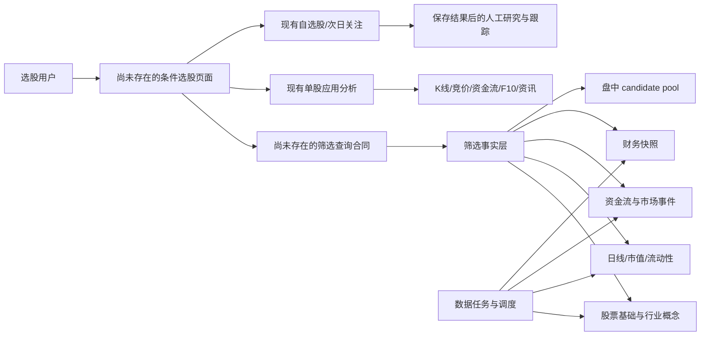

# Findings

## 2026-08-16 Phase 24 AI intent screening

- 当前 `stock_selection_ai_screening` 的 `researchIntent` 会进入可信快照和模型 Prompt，但它只影响模型的研究解释，不参与候选生成；候选仍由左侧结构化条件调用 Market Screener 后按既有排序截断。
- 当前候选快照只有当日 `volumeRatio`、成交额、涨跌幅、振幅与区间收益；没有连续缩量、相对前序均量倍数、OHLC 实体或突破的历史派生字段。因此“持续缩量后 3 倍爆量大阳线”不能由现有 AI 或现有规则严格验证。
- 已有 `a_stock_daily_screening_fact` 提供日频 OHLCV、前收、成交额，2026-08-14 物化覆盖为 5,541 / 5,541；它适合作为新历史形态因子的受限读取来源，但现有实时 Screener serving path 不能被直接替换。
- 现有 `market.stock_screener` 已是 bounded Agent read。新增意图解析是 AI capability，不应把任意自然语言直接转为 SQL；形态筛选将作为现有 Screener 的有界领域条件，复用既有 Agent 工具并在 schema 中补充受限参数。
- Phase 24 resumed: the existing plan identifies a safe implementation order. The first delivery is a deterministic historical price/volume pattern condition; AI must not be allowed to claim a match until that same condition takes part in the trusted candidate query.
- The serving Screener already constructs a bounded all-market daily snapshot, so the pattern can be expressed as typed criteria and evaluated by the existing domain policy. The durable `a_stock_daily_screening_fact` projection has the necessary OHLCV fields and an indexed `(code, trade_date DESC)` access path; its current one-day materialization means the rollout must either backfill a bounded history or explicitly report insufficient pattern coverage.
- Pattern contract selected for the initial vertical slice: N prior sessions must be successively lower volume (N = 2..10); the current volume must be at least a configured multiple of the mean volume across those N sessions; and the current real body `(close - open) / prev_close * 100` must meet the configured positive minimum. The three conditions are independently exposed, but the AI parser will emit all three for the named phrase.
- The new pattern stays inside the existing bounded `market.screener` read path. Its Agent schema was updated rather than creating a duplicate tool; it remains daily-close only, capped at ten prior sessions, and returns derived evidence rather than raw history.
- 2026-08-16 runtime acceptance: a bounded 30-session materialization (`2026-07-06` to `2026-08-14`) wrote 165,854 A-share facts with 100% source coverage. The production Screener now evaluates the supported phrase as an actual hard filter: 3-session contraction + at least 3x breakout volume + at least 5% bullish body returned only `SZ:301365` on 2026-08-14, with evidence `3 days / 3.6488x / 12.7798%`.
- The production intent-plan endpoint resolves the phrase deterministically to the same three typed criteria. The real AI execution used `stock_selection_ai_screening / openai_compatible / gpt-5.4-mini / v1`, recorded `SUCCEEDED`, and received a trusted one-candidate snapshot containing only `301365 矩阵股份`; its structured explanation identified that exact stock. This establishes that the natural-language intent now constrains candidate generation before AI explanation.

## 2026-08-16 Phase 25 requested workflow

- The user requires semantic, non-brittle interpretation: “持续缩量” is an unspecified multi-session contraction rather than a fixed three sessions, and “三倍爆量” is an intensity expression rather than an exact 3.0x threshold. The AI planning response must expose the confidence/assumptions and produce only bounded, executable Screener indicators for the user to edit and approve.
- The target product flow is one governed lifecycle: AI plan -> editable criteria -> saved/versioned strategy -> full-universe or target-symbol backtest -> one of multiple named watchlists -> post-add return observation and review. Existing strategy run, target backtest, and single ungrouped watchlist capabilities must be inspected for extension points before modifying contracts.
- The first Phase 25 slice establishes the required AI boundary: the old parser was a deterministic text rule that never invoked a model. It has been replaced by a distinct `stock_selection_ai_intent_planning` capability, DB-managed prompt and route. The model can only propose fields from the server-provided Screener allow-list; the server validates the result and exposes assumptions for explicit user editing/application.

## 2026-08-16 Phase 25 target-list backtest

- A target-list replay cannot reuse the full-market ranked result and then filter it: a requested symbol might be a valid historical match beyond the top-N candidate limit. The implementation therefore invokes the existing exact-symbol governed evaluation once per target on every signal date.
- `targetSymbols` is bounded to 50, normalizes `SH` / `SZ` / `BJ` and six-digit codes, removes duplicate market/code pairs, and is mutually exclusive with the legacy single-symbol fields. It is included in the existing immutable JSONB backtest config, so no schema migration is required.
- Overall strategy-health evidence explicitly excludes both legacy single-symbol and target-list replays; neither is a representative full-universe measurement.

## 2026-08-16 Phase 25 user-strategy boundary

- The existing strategy catalog is platform-preset-only: definitions have a globally unique `strategy_code`, no owner or tenant scope, and the database type constraint permits only `SCREENER_PRESET`. The strategy domain, run, backtest, and health services currently load the unscoped catalog.
- The new create/update API is an explicit user action. It is intentionally excluded from the autonomous Agent registry: it mutates a private, versioned aggregate and this slice does not add the required preview → explicit confirmation → execute → audit Agent write lifecycle.

## 2026-08-16 Phase 25 named-watchlist foundation

- The old active uniqueness key is owner + stock, which prevents a stock appearing in more than one thesis/list. The new parent list migration backfills every existing owner into `My watchlist`, assigns all legacy items to it, then moves active uniqueness to `(watchlist_id, stock_code)`.
- The same migration reserves entry market, price and trade date fields. The next domain/API/UI slice must populate these only from the trusted strategy-candidate/run snapshot, never from user-supplied price data.

## 2026-08-16 Phase 25 return-observation design

- `StockSelectionBacktestMarketDataRepository` is the governed daily-bar port already used for strategy replay; its ClickHouse adapter is an appropriate read-only source for watchlist observation. The observation flow will reuse the port, not expose a mapper or arbitrary historical query to the UI.
- The strategy candidate snapshot already freezes `market` and `price`, while `strategy_run.actual_trade_date` freezes the entry trading date. Entry return therefore uses the persisted entry price; latest close comes from `daily_raw`. The benchmark is fixed to `SH:000300` and is aligned on the stored entry trade date and each security's latest available trading date.
- To preserve bounded reads, the port will add one batch latest-quote operation for at most 100 securities; historical bars are queried only for the single benchmark series from the earliest eligible entry date. User watchlist writes remain intentionally excluded from the autonomous Agent registry; a future owner-scoped performance read can be evaluated separately once its API contract is complete.
- Agent exposure decision: the named-list mutations remain explicit UI writes and are not autonomous Agent tools. The owner-scoped performance endpoint is deliberately not added to the autonomous Agent catalog in this slice: it is a view-specific, current-price observation coupled to the private review workflow, has no Agent interaction contract yet, and would duplicate the existing page's bounded refresh. Any future Agent exposure must first define an owner-scoped named-list/limit input contract, output citations and staleness semantics, plus handler/schema/governance tests; it must not wrap this controller directly.

## 2026-08-16 Phase 26 historical watchlist observation

- The released watchlist overview correctly presents latest return and benchmark excess, but it is a point-in-time summary. The user-facing “watch 后的收益观测” needs a bounded historical path to make deterioration, recovery and benchmark divergence inspectable before a review decision.
- Implemented `GET /api/market/screener/watchlist/{itemId}/performance/history?limit=90`. It retains the frozen entry date/price as the baseline, reads daily stock and `SH:000300` closes through the governed market-data port, and returns a 30–252-point owner-scoped series with return, benchmark return, excess return, source and warnings.
- The Watchlist `Observe` action opens a dedicated data-state-complete dialog with the entry context, latest comparative values and a bounded line chart. It complements, rather than replaces, the existing Trade Review action.
- Agent exposure remains intentionally excluded: this view-specific, private observation is coupled to the review workflow. A future tool requires a separate owner-scoped named-list/limit contract, source citations, staleness semantics and handler/governance tests; it must not wrap the controller.

## 调研范围

- 本次只读，不修改业务代码。
- 重点关注市场数据、行情查询、指标计算、筛选/排序、AI能力、前端工作区和运行依赖。

## 2026-08-15 企业级闭环实施原则

- 三个入口（Indicators / Strategies / AI screening）必须落到同一条可审计链路：`screening_run -> candidate -> evidence -> signal -> evaluation -> watchlist_review`；不能分别返回不可对齐的临时列表。
- 策略必须版本化，保存每次运行的参数、股票池、交易日、数据来源/覆盖率和命中证据，才能复现“为什么今天选出它”。
- 回测与当日策略健康度不能只依赖累计收益：必须冻结历史时点、避免未来函数、计入成本，并按市场状态/行业/持有期拆解。
- AI 选股不是前端文案或自由文本直连模型；在 capability、Prompt、Provider、usage binding、结构化输出校验、执行日志和 AI Provider UI 路由齐备前，只能作为明确的非执行占位。
- 观察池是结果承接的正式对象，至少需要状态、原因、失效条件、下一次检查、信号关联与人工复盘结论；现有自选股可复用为展示/入口，但不足以替代此工作流。

## 2026-08-15 观察池实现边界（第 16 阶段）

- 观察池写入由用户在策略候选的 `Watch` 操作显式发起：候选必须通过 `candidate -> strategy_run` 的 tenant/owner 联结验证，不能用前端提交的股票代码绕过策略证据。
- 新增操作以当前 scope 下的活动股票（`WATCHING` / `PAUSED`）幂等；记录关注原因、可选失效条件和下次复盘日期。复盘以 `CONTINUE`、`PAUSE`、`INVALIDATE`、`ARCHIVE` 映射生命周期状态，并由乐观锁保护。
- 观察池列表、创建和复盘由 market API 的 DTO/AppService 层对外提供；领域 scope 不泄漏到接口，复盘更新与审计记录在一个应用事务内完成。
- 这是用户主动的写操作，不适合作为 Autonomous Agent Tool 暴露；若未来需要 Agent 发起，必须先扩展 preview → explicit confirmation → audit 的写入协议。

## 2026-08-15 机会信号复用边界（第 17 阶段）

- `market_indicator_events` 已按 `(trade_date, code, event_type, event_minute)` 唯一约束写入；它能作为可追溯、分钟去重的机会信号事实，保留触发时间、价格、涨跌幅、信号值、状态和来源。
- Screener 直接复用既有只读 `/api/market/indicator/latest`，不复制第二套信号存储或制造未经验证的“即时”数据。信号面板明确其只是复盘证据，点击股票仍进入 Trade Review。
- 现有 Market Indicator 查询/传导读取已经是成熟领域合同；本次仅复用现有前端服务，不新建基础后端 API 或 Autonomous Agent tool。后续若增加筛选专属信号聚合 API，再单独评估 bounded read-only Agent exposure。
- 运行时超时根因不是事件表本身，而是候选池 CTE 用相关 `EXISTS` 在 14GB 的 `market_indicator_snapshots` 上验证可用采集时点。事件查询只读取约 4 万行；为 `(trade_date, captured_at, code)` 的有效快照补 partial index，可使验证按 capture 走索引。

## 2026-08-15 企业级实施核查（第 13 阶段）

- CodeGraph 索引当前可用（3,188 文件、58,162 节点），但 CLI 查询子命令是 `query` 而非 `search`；后续先用 `codegraph query/callers/impact`，必要时用 `rg` 回退。
- 可复用的市场基础比原先预估更丰富：Python `market_technical.py` 已有市场状态、行业强度和相似场景回测纯计算；`market_indicator` 已有有限候选池和事件采集，但仍不能直接承担用户定义策略的全市场候选合同。
- 现有 `stock-chart` 前端的技术指标回测仅是单股前端计算，不能作为企业级策略回测引擎；企业级回测必须在服务端冻结股票池和历史时点。
- 当前自选股/portfolio 与“交易导入候选”是已有的个人持仓/导入工作流，不能直接复用为策略候选或观察池持久化模型；可复用其 owner/tenant 边界与列表展示模式。

## 初步架构发现

## 2026-08-15 分层行业、概念与风格筛选

- 用户反馈正确：当前页面只有 THS 行业叶子筛选，未把既有 THS→TDX 行业映射作为行业大类，也没有暴露已有的 TDX 概念、风格成员关系。
- `tdx_ths_industry_mapping` 有 98 条有效映射，覆盖 90 个 THS 行业叶子与 54 个 TDX 行业大类；应以每个 THS 行业的 primary/high-priority 映射生成 TDX 大类选项，并与 THS 叶子条件取交集。
- `sec_sector` / `sec_stock_sector` 的实际覆盖足以开放：概念 270 个、5,393 只股票/46,436 条关系；风格 149 个、5,279 只股票/20,861 条关系。此前仅有 8 条的是另一张 `a_stock_concept_membership`，不应阻止使用这组成熟的 TDX 关系表。
- 实现口径：行业大类来源为 THS 日快照与 TDX 映射；概念和风格来源为 TDX `sec_sector` / `sec_stock_sector` 静态成员关系。三类选择条件与其它条件均按 AND 关系筛选，行和详情须暴露匹配用的 TDX 行业、概念、风格信息。

- 仓库是 Java 多模块 + Python Job Executor + React/Vite UI；市场能力主要集中在 `cynexus-market`、`cynexus-data` 和 `cynexus-ui`。
- CodeGraph 索引已同步，当前约 3,176 个文件、57,944 个节点；仓库本身存在大量与本任务无关的既有工作区变更，不能据此判断本次功能是否已实现。
- 市场后端已有统一只读研究合同 `MarketResearchFeignClient`，覆盖股票搜索、元数据、行业关系、板块成分、资金流、分时、竞价、F10、市场情绪、行业资金流、融资融券、市场指标回放、ETF、期货持仓、市场脉搏、资讯和数据新鲜度。
- AI 层已有 `MarketDataGateway` 和市场研究 Agent 工具 schema，把上述市场查询按股票研究、F10、情绪、行业、融资融券、指标、ETF、期货、市场脉搏等分组；目前是读取能力，不等于已有“按条件筛选全市场股票”的查询能力。
- `cynexus-data` 已有股票基础资料、交易日历、板块/行业关系、日线/分钟线、复权日线、换手率、资金流、融资融券、ETF、行业报价、涨停/连板/情绪、市场热力图和情绪指标等同步与构建任务。
- UI 路由已有 Stock Overview、Market Pulse、Market Sentiment、Market Indicator、Industry Application、Self-Selected、Stock Chart、Personal Portfolio、Trade Review、A-Stock Skill POC 等入口，产品形态是密集型研究工作台，而不是独立的选股器页面。

## 已有能力分层

### A. 可直接作为“选股结果行”的正式查询能力

| 能力 | 当前接口/来源 | 可用字段或交互 | 结论 |
| --- | --- | --- | --- |
| 股票基础与搜索 | `/api/market/stock-chart/search`、`/stock-meta`、`/api/market/sec-stock-basic` | 代码、名称、市场、行业、市值、规模风格、ST/板块等 | 可作为股票主数据和搜索；基础 CRUD 列表无条件/分页筛选 |
| 行业/概念/风格 | `/stock-sectors`、`/sector-stocks`、THS 成分快照 | 归属关系、板块成分、板块内行情、市值、换手、5/10/30/60/252 日收益 | 适合做“按板块缩小股票池”和结果行补充；尚非通用多条件筛选 |
| 日线与技术字段 | ClickHouse 日 K / qfq，经 `StockChartQueryDomainService.dailyFeature` 计算 | 收盘价、涨跌幅、换手率、20 日量比、趋势标签；股票详情可读更长 K 线 | 单股特征接口；批量筛选需要把计算下沉为批量查询或物化因子 |
| 资金流 | `/stock-chart/fund-flow`、`a_stock_fund_flow_daily`、`stock_fund_flow_snapshot`、ClickHouse 分钟资金流 | 主力/超大/大/中/小单、主动净额、成交额、资金流历史 | 单股已较完整；全市场筛选需统一 source、时点和覆盖语义 |
| 市场指标/事件 | `/api/market/indicator/latest`、`industry/detail`、`radar/events`、`limit-board/summaries` | 涨跌停状态、快速上涨/下跌、异动事件、行业宽度、候选池覆盖 | 可做“事件型选股/盘中关注池”；本质是有限采集池和市场雷达，不是任意条件引擎 |
| 财务快照 | Python `sina_financial_report` 归一化到 `a_stock_financial_snapshot` | 营收、营收同比、净利润、归母/扣非、经营现金流、资产负债、EPS、ROE、毛利率、净利率、估值、股息率 | 数据层已为筛选预留索引；Java/Agent/UI 目前没有正式读取链路 |

### B. 已存在但不能直接等同于通用选股的能力

1. `market_indicator_candidate_pool`：用于盘中行情采集的候选股票集合。Python 通过 `hot_signal`、`rotation`、`coverage` 选择有限样本，默认候选上限约 800；它解决采集成本和传导分析，不代表“满足用户条件的股票”。
2. `a_stock_daily_screening_fact`：数据库迁移已定义日线筛选事实表，含 OHLC、涨跌幅、振幅、成交量、成交额、换手率、总/流通市值和复权收盘价，并建立日期、股票、流动性索引；当前仓库中未找到写入 pipeline、Java PO/Mapper、查询 DTO 或 controller。
3. `a_stock_financial_snapshot`：Python 已对新浪财务报表做结构化归一化并写入；当前没有面向全市场的最新报告期选择、公告日防未来函数、财务字段筛选和覆盖质量查询。
4. A Stock Skill POC：`/api/market/a-stock-skill/datasets` 与 `/datasets/{code}/rows` 只支持选择数据集、按 code/source 过滤和 limit，UI 展示原始表格；它是数据目录/核查工具，不是条件选股器。

## 能力地图

### C. 当前可实现的产品形态

现有代码可以较低成本拼出一个“研究型选股 MVP”的界面骨架：顶部为交易日/数据新鲜度/市场环境，左侧为股票池和条件分组，中间为密集结果表，右侧抽屉复用 Application Analysis 的单股深度分析；结果行可以进入 K 线、资金流、竞价、F10、资讯，或加入现有自选分组。

现有页面已经提供可复用的视觉和交互语言：

- `Market Indicator`：Tabs、搜索、异动/涨跌停/快速变化视图、行业详情、回放和条件化关注清单。
- `Market Pulse`：强势板块、资金流、行业轮动、历史排名和多行业对比。
- `Application Analysis`：K 线、AI Direction、竞价、指标、资金流、资讯、Profile 七个单股研究页签。
- `Self-Selected`：分类 Tabs、股票卡片、行业/概念/风格标签、备注、进入分析和加入 target。
- `A Stock Skill POC`：数据集目录、数据字典元信息、code/source/limit 查询、原始表格。

因此第一版不需要另造单股详情能力，但需要新增“股票池、条件、批量结果和筛选保存”四个产品对象。

## 2026-08-15 实现偏差复盘

- 已实现页面把一级路由做成“空白入口页 + 打开选股 Dialog”的两步流程；这没有服务于研究工作流，也掩盖了核心操作。
- 已实现 Dialog 只有基础输入和结果表，缺少既定方案中的市场上下文、可扫描的条件分组、结果操作条和不离开结果上下文的单股研究入口。
- 当前真实 API 仅支持日线收盘后的市场、价格、涨跌幅、成交额、市值和行业筛选；UI 必须明确这项日频 MVP 的数据边界，不能以空壳形式暗示尚未接入的财务、资金流和保存筛选能力。

## 2026-08-15 多维 MVP 实施结论

- 竞品（Finviz、TradingView、问财及既有国内竞品研究）的共同结构是：股票池/分类、技术、基本面、资金/流动性和排序列的组合；区别主要在自然语言入口、预设/预警、回测和研究联动。Cynexus 这一版优先实现可核验的条件与研究联动，不把覆盖不足的财务字段伪装成全市场能力。
- 已接入的真实筛选维度：市场、上市板、行业、ST 排除、价格、单日涨跌幅、振幅、5/10/30/60/252 日收益、成交额、市值、当日主力净流入和 5 日主力净流入；所有范围在 domain policy 统一校验、筛选和排序。
- 主力资金流由 `a_stock_fund_flow_daily` 按 code/date 先去重，再取最近一日与五个交易日累计值；不会按结果行逐个查询，也不会混合多源重复快照。
- 财务维度仍明确不可用：现有 `a_stock_financial_snapshot` 覆盖仅 8 个股票，不符合全市场选股的质量口径。下一阶段应先建立全市场财务覆盖、公告日约束和 coverage/freshness 再开放 ROE、增长、估值等条件。
- UI 改为默认打开的完整 Dialog panel：左侧为分组条件构建器，右侧为可排序的密集结果表，点击股票在右侧 Sheet 中查看筛选因子后再进入 Application Analysis，筛选上下文不再立即丢失。

## 2026-08-15 二次能力核查：关联维度

- 用户指出的问题成立：原始 `industry` 是股票基础资料的字符串精确匹配，不是可选择、可追溯的行业成分关联，产品上不能称为行业筛选器。
- `ths_industry_constituent_snapshot` 在 2026-08-14 覆盖 5,548 个股票、90 个 THS 行业；同一份日频快照还覆盖换手率 5,550 条、量比 5,549 条、PE 4,105 条。它可以在同一交易日口径下提供行业归属、行业筛选、换手率和量比；PE 必须标注约 74% 覆盖。
- `sec_stock_sector` 覆盖 5,525 个股票、3,090 个关联：行业 2,675、概念 269、风格 146，包含可用的行业/概念/风格关系。但 `a_stock_concept_membership` 当前只有 8 个股票，不应把它作为全市场概念筛选来源。

## 明确缺口

### 产品/API 缺口

- 没有选股条件模型：缺少字段、运算符、值、AND/OR 分组、排序、分页、结果列配置和版本化保存。
- 没有通用批量结果 DTO：目前只有单股查询、板块成分、有限候选快照或专用排行接口。
- 没有统一数据口径：腾讯、东财、TDX、THS、ClickHouse、财务报告期数据并存，结果必须携带 source、asOf、reportDate/tradeDate、coverage 和 freshness。
- 没有回测/历史选股结果能力：目前虽有日线和市场事件历史，但没有“按历史时点执行条件并看后续收益”的合同。
- 没有保存筛选器/订阅/触发记录；已有自选股可以作为结果承接，但不能替代筛选器定义。

### 数据缺口

- `a_stock_daily_screening_fact` 当前只有 DDL，尚未确认有持续写入和质量检查任务。
- 财务快照需要明确“最新有效报告”的选取规则、公告日约束、报告期与交易日对齐及缺失率。
- 多个字段只保证单股或自选池覆盖，不能直接承诺全市场：尤其 120 日资金流、分钟资金流、竞价、F10、新闻、龙虎榜和互动数据。
- 行业/概念关系存在多个来源和口径，应在查询层固定主口径并保留 source，不可把 THS、TDX、东财排名直接混合。
- 盘中指标采集是采样池，不等于全市场实时覆盖；页面已有 `coverageRatio` 和 `fullConfirmationRequired`，这套质量语义应继承到选股结果。

### 架构缺口

- Java 侧需要新增 selection query 的 API/domain/application/infra 链路，而不是让 UI 拼接多个单股接口。
- 需要批量 SQL/物化视图或 ClickHouse 查询，避免对每只股票逐个调用行情/资金/F10。
- Agent 侧暂未发现通用选股工具；若开放，应限制最大返回、条件复杂度、时间范围和数据新鲜度，并给出来源引用和免责声明。

## 建议的 MVP 边界

建议首版只做“日频收盘后、可解释、可分页的股票筛选”：

1. 股票池：全 A 股/沪深/北交所/板块/行业/概念，排除 ST、停牌和上市不足 N 日作为基础排除条件。
2. 结果字段：代码名称、行业、最新价、涨跌幅、成交额、换手率、振幅、总/流通市值、5/10/30/60/252 日收益、20 日量比。
3. 基本面：ROE、营收同比、净利润同比、毛利率、资产负债率、PE/PB、股息率；所有财务字段显示报告期和公告日。
4. 排序与保存：支持结果排序、分页、列显隐、保存筛选条件、把结果批量加入已有自选分组。
5. 单股联动：点击结果行打开现有 Application Analysis，保留筛选上下文返回。
6. 质量提示：展示数据日期、抓取时间、来源、覆盖率、缺失字段数量；对分钟/竞价/资金流等不在 MVP 中的字段标明“仅部分覆盖/按需加载”。

## 证据索引

- 市场研究合同：`cynexus-market/cynexus-market-api/src/main/java/cn/cccs7/cynexus/market/api/feign/MarketResearchFeignClient.java`
- 股票字段和板块成分：`cynexus-market/cynexus-market-api/src/main/java/cn/cccs7/cynexus/market/api/dto/StockChartDTO.java`
- 单股特征逻辑：`cynexus-market/cynexus-market-domain/src/main/java/cn/cccs7/cynexus/market/domain/service/stock/impl/StockChartQueryDomainServiceImpl.java`
- 选股预留表：`deploy/local/postgres/migrations/20260728_create_stock_screening_tables.sql`
- 财务快照归一化：`cynexus-data/src/cynexus_data/domain/stock/a_stock_persistence.py`
- 盘中候选池：`cynexus-data/src/cynexus_data/domain/market/market_indicator.py`、`cynexus-data/src/cynexus_data/pipelines/market/market_indicator_refresh.py`
- 数据能力目录：`deploy/local/postgres/migrations/20260708_create_provider_capability_catalog.sql`
- 市场指标页面：`cynexus-ui/src/views/data-collector/market-indicator/index.tsx`
- 单股分析页面：`cynexus-ui/src/views/application-analysis/index.tsx`
- 自选股页面：`cynexus-ui/src/views/self-selected/index.tsx`
- A 股数据集 POC：`cynexus-ui/src/views/poc/a-stock-skill/index.tsx`、`cynexus-ui/src/services/market/a-stock-skill.ts`

## 2026-08-15 企业闭环合同核查（续）

- CodeGraph 当前索引存在 4 个新增、12 个修改待同步；进入共享选股符号的精确调用链检查前必须先同步索引，不能基于旧索引改动。
- 当前工作区已有 137 个文件的无关或并行变更，选股相关实现也尚未跟踪；后续仅新增本能力所需文件或修改已归属的选股文件，禁止清理、重排或覆盖其他任务的改动。
- 现有 `StockScreenerQueryDomainService` 的影响边界至少包括 Controller、AppService、DomainService 实现和 focused domain test；它适合继续承担“实时可解释条件查询”，但不应被扩展为策略定义、版本、运行冻结或观察池生命周期的聚合根。
- 设计结论：策略闭环应以独立 `strategy` 边界承载定义/版本/运行/候选证据，复用现有 Screener 作为首批策略的候选计算器；观察池以独立 owner/tenant 聚合承接人工决策，不能复用只表达自选清单的 `SelfSelectedList`。
- CodeGraph 已同步成功。`MarketResearchFeignClient` 已有 `getStockScreener`，但该共享 Feign 接口的影响范围达 102 个符号；策略 MVP 的首个纵向切片应先在 Market 内部 API 完成，再仅在确有跨模块调用时谨慎扩展 Feign 合同。
- 现有 `MarketIndicatorController` 已有 preview/confirm 的“watchlist”接口，但其语义是市场指标关注清单，不是个股观察池，不能以相同名称/表直接承载策略候选的人工跟踪、失效理由与复盘决策。
- `MarketIndicatorWatchlistAppService` 直接使用 Map/JSON 与旧 `MarketDataCrudDomainService`，不符合本功能要建立的 DDD 聚合、审计与 owner/tenant 边界标准；它可作为交互措辞参考，但不作为实现模板。
- 策略候选的计算入口应调用当前 `StockScreenerQueryDomainService`；该 repository 对外只有快照和分类选项读取，策略运行的持久化需要新建独立 domain repository，而非把运行状态塞入筛选 repository。
- Screener 已在领域层把候选计算收束为 `QueryInput → Query → Snapshot → Result`，并返回实际交易日和 source；策略运行可以将对应条件参数、实际快照日、source、筛选总数及排序后的候选行冻结成可重放证据，且无需让 Application 层参与计算。
- `a_stock_daily_screening_fact` 和 `a_stock_financial_snapshot` 只有事实/快照 DDL，没有策略运行或人工跟踪生命周期表。策略状态必须以新迁移建立，不可依赖 JSON 原始载荷或前端本地状态。
- 现有股票筛选 policy 已集中处理日期、范围、排序、分页与无效输入；策略定义首期不开放任意表达式，固定为受审计的 `SCREENER_PRESET` 类型，参数必须复用该 policy 能表达的字段。这样可保证版本参数可验证、可解释，避免以 JSON DSL 引入未受控条件。
- Market 基础持久化使用 MyBatis-Plus mapper/basic-service + Snowflake ID；策略新表遵循这条基础设施模式，并由新的 domain repository 进行转换。当前未发现 Market 模块通用 tenant 上下文，第一期 owner 需显式从受信任服务端身份解析而非客户端字段；继续定位现有 owner 实现。
- 已确认筛选 policy 的全部可用受控字段，并且它对缺失可选字段采取“未配置条件可保留、配置条件即淘汰”的语义；首批预设策略应限定在这些字段，以保证缺失数据不会产生虚假命中。
- 当前 Market 自选清单 PO 仅继承基础审计列，没有显式 owner/tenant 字段；企业化策略/观察池不能沿用这种隐式单用户假设。须在新表中显式存 `tenant_id`、`owner_id`、`created_by`/`updated_by`，且 API 禁止接受这些字段作为客户端参数。
- Market Release migrations 是一份显式白名单。新增策略迁移除了写入 `deploy/local/postgres/migrations` 外，必须追加到 `deploy/release/apply-market-migrations.ps1`，否则不会进入 Release。
- 网关已可通过签名的 `X-Cynexus-Principal`、`X-Cynexus-Tenant` 注入可信身份，默认值仍是 `workspace-user/default`。策略与观察池应复用现有服务端签名验证器解析这两个值，禁止接受客户端 owner/tenant；Phase 14 先核查该验证器的 MVC 接入方式。
- `BasePO` 只提供 id/时间戳，不提供 owner/tenant；`MetaObjectFillHandler` 的 actor 是静态值，因此策略数据必须显式存 scope 以防止按已知 ID 越权。网关在禁用身份密钥时不会插入任意客户端 header，解析器应退回配置化的本地工作区身份；开启密钥时必须拒绝未签名/签名无效的请求。
- 现有 Portfolio 仍硬编码 `workspace-user/default`，不能满足本功能的企业级隔离要求。新增 `StrategyIdentityResolver` 将放在 Market Application 边界，读取并验证网关头后只向 domain 传入不可伪造的 `StrategyScope(tenantId, ownerId)`。
- 可复用的身份验证实现是 AI 的 `AgentIdentityResolver`：验证签名，只有在配置明确允许时才允许无头单用户退回。Market 将按相同规则实现，不引入对 AI 模块的依赖。
- Portfolio import 已有“domain port + infra adapter + 领域服务 Configuration 装配”的较新 DDD 实现，可作为策略运行/观察池持久化的结构模板；不能复用其投资组合业务对象。
- 新策略 repository 将采用 Portfolio import 的 owner-scoped find/list/update 规则和显式 optimistic version 语义；每次按 ID 读取都必须同时带 tenant/owner 约束，不能只依赖业务层检查。
- Phase 14 合同已冻结：系统策略定义/版本只读；运行记录为 owner-scoped、不可变事实；候选/证据从运行侧读取；观察池项目是 owner-scoped 状态聚合并保留 review 历史。第一期写 API 只允许“将某次候选加入观察池”和状态更新，不能编辑策略版本。
- 迁移和 mapper 的具体模式已确认：`principal_key/tenant_key` 在所有 owner-scoped 查询中并列，更新以 `version = previous + 1` 进行乐观锁；本功能将采用同等安全门槛，并以命名上的 `owner_id/tenant_id` 表达业务语义。

## Phase 14 实现（进行中）

- 已新增策略/版本、运行、候选、候选证据、观察池和 review 的 PostgreSQL 合同。策略定义与版本为系统治理对象，运行与观察池显式包含 `tenant_id/owner_id`，候选证据从属于不可变运行事实。
- 已新增真实的策略目录 API：`GET /api/market/screener/strategies`。它经 Controller → AppService → DomainService → Repository port → MyBatis adapter 查询 active 的策略定义及其 active version；不会把未运行的策略伪装成选股结果。
- 初始 migration seed 的第三项命名为“板块归属动量”，并明确它只证明分类归属与个股动量，不声称未接入的行业强度/轮动因子。
- 前端接入将保留现有 Screener 的 panel 工作台结构，不改路由/side bar；Strategies Tab 必须通过 service 层读取真实策略目录，并完整呈现 loading/error/empty/unavailable/success 状态，不能再以静态占位表达已上线能力。
- `CynexusScreenerPage` 已通过路由 lazy loading 控制主 bundle，原有 `fetchStockScreener` 的影响仅限选股页面。策略目录将增加独立、轻量的 service 函数，在 mode 切到 Strategies 时按需加载，避免阻塞指标筛选的初始读取。
- 已将 Strategies Tab 接到真实目录 API，并提供 loading、error/retry、empty 和 success 卡片状态；每个策略展示其受治理版本、生效日期、变更摘要并可将版本条件原子替换到 Indicators 模式作预览。该预览使用现有实时查询，尚不会写入 strategy run，因此不表述为已审计的策略运行结果。

## Phase 14 验收结论

- 数据模型、Release migration、策略目录 DDD API、三个系统策略 seed 和 UI 可见性已经具备。策略定义不允许从前端创建或改写；其发布入口需后续治理流程，不在本次运行时切片内。
- Phase 15 必须将“Preview rules”升级为显式策略运行：后端执行版本条件、保存 owner-scoped run/candidate/evidence，并返回受限的同步候选集。由于该操作会写入用户范围数据，不向 Autonomous Agent 暴露；若未来需要 Agent 发起，必须另建 preview/confirmation/audit write 合同。

## Phase 15 实现（进行中）

- 已建立受限同步运行：只允许已发布策略目录中的 code；运行固定版本的 JSON 参数，通过现有日频 Screener 获取候选，并保存 run、候选、字段级 evidence 和事实快照。每次运行将存储至多 100 个候选，并把总命中数和截断警告一并返回，避免无界持久化。
- 已实现三类确定性评分和可读证据：趋势动量用 10D/30D 回报、量比、换手；资金共振用成交额/主力净流入、量比、换手；板块归属动量以 TDX 归属存在性与个股动量作为事实。评分和证据不调用模型，也不声称不存在的行业强度。
- 策略运行 API 为 `POST /api/market/screener/strategies/{strategyCode}/runs`，使用签名 `X-Cynexus-*` 可信身份；仅当没有任何身份头且部署明确允许单用户 fallback 时使用本地默认范围。客户端不能提交 owner/tenant。
- 策略运行响应携带运行 ID、策略版本、实际交易日、评估股票池规模、总命中数、受限持久化候选和每个候选的字段级 evidence；前端应以该不可变结果为准，不能把它重新包装成可排序、可翻页的实时指标查询结果。
- Release 运行验证：`TREND_MOMENTUM` 在 2026-08-14 实际快照下评估 5,514 支证券，命中 206 支，冻结前 100 个候选及 400 条 evidence。运行写入被 tenant/owner scope 保护；Release compose 已显式把网关同源 `CYNEXUS_TRUSTED_IDENTITY_SECRET` 注入 Market，避免客户端可伪造身份或运行端无签名密钥。

## Phase 13 验收结论

- 企业策略首期范围固定为 3 个受控、日频收盘后策略：`TREND_MOMENTUM`、`VOLUME_CAPITAL_RESONANCE`、`INDUSTRY_RELATIVE_STRENGTH`。每个策略定义对应不可变版本，运行快照保存请求日、实际交易日、参数、source、覆盖/警告、候选评分和字段级证据。
- 观察池与策略是不同聚合：观察池记录人对候选的继续跟踪/失效/复盘决定；策略候选记录一次运行的事实，永不以观察状态覆盖或删除。
- 本纵向切片不启用财务、盘中、回测、AI 与自动写入；这些留给后续阶段，避免未经覆盖、历史对齐或 confirmation 合同验证的能力进入生产。

## 2026-08-15 Phase 17 验收

- 运行时阻塞来自任务自身的历史 smoke、`EXPLAIN ANALYZE` 与在线建索引并发占满 Market 数据库连接。确认后仅终止了这些精确匹配的任务会话，未触碰共享基础设施或其它业务查询；失效索引已 `DROP INDEX CONCURRENTLY` 后重建为有效状态。
- 单有 `(trade_date, captured_at, code)` partial index 不足以解决端点延迟：`latest_candidate_capture` 以 CTE join 引用交易日时，PostgreSQL 仍扫描约 917,980 条候选。改为标量子查询后，`idx_market_indicator_candidate_pool_latest` 只取首行；同时在所有快照读取处显式绑定 `s.trade_date`，使新 partial index 可命中。
- 代表性 `EXPLAIN ANALYZE` 从约 8.23 秒降至 12.23 ms（5,514 条有效快照）。Release `market,ui` 已重建，随后 Market 修复重新构建并启动。网关验收：`latest?status=all&limit=10` 为 200 / 1534 ms，`radar/events?kind=all&limit=5` 为 200 / 1310 ms；Release UI `/cynexus-screener` 为 200。

## 2026-08-15 Phase 18 初步发现

- 受治理策略已可按历史 `tradeDate` 调用同一 Screener 领域服务，且每个筛选快照返回实际可用交易日；因此可用它重放历史信号日，不能以当前候选或未来收益反推历史入选。
- 现有策略运行表只保存一次运行的候选/证据，没有回测批次、交易规则、逐笔持有期结果或指标汇总；必须新建独立回测聚合，不能把绩效 JSON 塞回运行事实。
- 现有 Stock Chart 领域查询只提供单标的日线列表；企业回测的批量前瞻价格读取应通过 Market 的受限 repository port 增加，而不在应用层循环 HTTP/Chart API。
- 该结果是 owner/tenant-scoped、限窗且只读的用户可见分析，适合评估为一个单独的 bounded Agent read tool；它不能接受任意 SQL、股票池或无限日期范围。
- 本阶段暂不新增 Autonomous Agent 回测读取工具：现有跨服务 `MarketResearchFeignClient` 没有传播可信 tenant/owner 签名的合同，直接复用会破坏回测结果的 owner-scoped 边界；同时回测运行是用户显式发起的高成本写操作。保留 UI/API 的身份保护，并将 Agent 读取列为 Phase 21 的前置合同工作，而不是以无 scope 的 Feign 读取越权暴露历史结果。

## 2026-08-16 Phase 23 数据质量事实

- Screener 现阶段读取的是 `ClickHouse daily_raw` 与 PostgreSQL 的证券主数据、资金流、THS 行业成分和 TDX 板块关系的实时拼接，而不是 `a_stock_daily_screening_fact`。质量状态因此描述这条实际读路径，不能把未持续写入的事实表宣传为已经覆盖。
- 质量报告按每日最新可用交易日计算，并返回 eligible 股票数、日线快照数、交易日滞后、8 个字段的实际可用数/覆盖率及可操作 warning。`PE` 为 4,079 / 5,530（73.76%），被明确标记为部分覆盖，不能理解为全市场完整财务筛选。
- 2026-08-14 实测：日线/成交额/30 日动量/资金流/行业/换手/量比均为 5,514 / 5,530（99.71%）；最新交易日距日历 1 天，综合状态为 `READY`。这是一份可审计的 freshness/coverage 报告，不等价于已经具备历史事实回填任务。
- 下一实施子项应在 `cynexus-data` 建立专用的日频 Screener 覆盖与回填任务、失败告警和历史 watermark，再决定是否让 `a_stock_daily_screening_fact` 成为稳定读取源；在此之前，产品和运行文档必须保持上述数据边界。

## 2026-08-16 Screener 日频事实回填与监控

- 新增 `materialize_stock_screening_facts` Data Executor job：以 `daily_raw` 为唯一输入，物化开高低收、前收、涨跌幅、振幅、成交量和成交额至 `a_stock_daily_screening_fact`；默认只处理最新交易日，`start_date/end_date` 支持受限历史回填，完成后写入 checkpoint watermark。
- 物化范围采用沪深北 A 股代码段，避免 `a_stock_daily_screening_fact` 既有自然键未包含 market 时的跨市场/指数冲突；每次在源读取成功后原子替换目标日期范围，防止历史遗留行造成假覆盖。
- 物化后立即比较来源去重行数与 PostgreSQL 事实数；不相等时 JobResult 为失败，核心调度可据此暴露异常。独立 `quality_check` 的 `screening_fact_coverage` 亦可执行相同只读核验。
- Release 实测（2026-08-14）`daily_raw` A 股投影为 5,541 行，`a_stock_daily_screening_fact` 为 5,541 行，覆盖 100%。该范围比当前服务端 Screener 结果的 5,514 日线行多 27 行：前者是日线 A 股事实，后者还会叠加 Java 侧证券主数据/可筛选性边界；两者不能混为一个覆盖口径。
