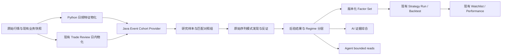

# Cynexus 市场事件因子研究系统实施计划

> 适用项目：`E:\project-repo\cynexus`  
> 计划基线：2026-08-16 当前工作区与 Release 能力  
> 目标：把现有“单日事件证据查看器”建设为可审计、可验证、可用于选股/回测/观察的企业级市场事件因子研究系统。  
> 本文是实施输入，不代表代码已经完成。

## 1. 最终交付目标

交付后必须完整回答以下问题，并且每个答案都能追溯到数据日期、来源、样本和规则版本：

1. 今天市场处于什么状态，MSI 九因子分别如何？
2. 哪些行业处于启动、扩散、高潮、分化或退潮阶段？
3. 今天哪些股票进入涨停、大涨或其他事件池？
4. 某只股票在事件前、事件中和事件后发生了什么？
5. 多个历史事件是否存在稳定公共特征，反例有多少？
6. 这些特征相对匹配对照组是否有显著提升，而不只是全市场共同现象？
7. 这些特征在不同市场情绪、行业周期和风格环境中是否仍然成立？
8. 因子组合能否被编辑、保存、版本化、转成策略并进行回测？
9. 选出的股票能否进入多个观察列表，并持续记录收益和失效条件？
10. AI 和 Agent 能否在严格证据边界内解释这些结果，而不是直接猜涨停原因？

## 2. 完成定义

以下条件全部满足才算完成：

- 单日事件详情、历史公共因子、对照组、后验收益、Regime 分层、因子组合、策略、回测、观察列表形成闭环。
- 任意研究结果都有 `studyId`、研究窗口、样本量、特征版本、数据截止时间、来源、覆盖率和泄漏检查结果。
- 任意候选因子同时显示支持证据、反证、事件组结果、对照组结果、lift/effect、稳定性和后验表现。
- AI 只读取已计算的证据和统计结果，不计算真值、不补充外部事实、不直接创建策略或观察列表。
- 新增 Agent read tool 使用严格 JSON Schema、有限日期/行数、tenant/owner 边界、source/freshness/citation；写操作走 preview-confirm-audit。
- 默认研究请求不再实时拼接全市场多源快照；交互读走物化数据或缓存。
- 关键 UI 读接口达到本文性能门槛，异步研究任务可观测、可重试、可审计。
- 聚焦测试、Maven 编译、UI 检查、Python pytest、迁移、版本同步和 Release 运行验证全部通过。

## 3. 保留、改造和停止使用的现有能力

### 3.1 直接保留

| 能力 | 当前落点 | 使用方式 |
| --- | --- | --- |
| 涨停/大涨事件来源 | `market_limit_daily_stocks`、`trade_review_security_daily_fact` | 作为首批 Cohort Provider 数据源 |
| 市场状态与日内回放 | `MarketIndicatorQueryDomainService` | 复用 `tradeReviewMarketState`、`replayTimeline`、transmission episode/outcome |
| MSI 九因子 | `msi_index_daily` | 九项独立特征，不压成一个黑箱分数 |
| 市场/行业分钟状态 | `trade_review_market_minute_state`、`trade_review_industry_minute_state` | 直接用于事件锚点前后的市场/行业路径 |
| 个股日线与 1m K | ClickHouse `daily_raw`、`ch_dwd_kline_1m` | 数据物化和个股回放 |
| THS/TDX 行业资金 | 现有 THS/TDX fund-flow 表与 API | 作为行业 Regime 独立证据 |
| 两融 | 现有 market/industry/stock margin API | 分市场、行业、个股独立输入 |
| 期货持仓 | `futures_position_*` | 作为 cross-market Regime 输入 |
| 策略版本、运行与健康度 | `stock_selection_strategy_*` | 因子集验证后复用，不新建另一套策略系统 |
| 回测 | `stock_selection_strategy_backtest_*` | 扩展 typed factor evaluator 和 lineage |
| 多观察列表与收益跟踪 | `stock_selection_watchlist*` | 继续使用 candidate -> watchlist 链路 |
| AI 路由治理 | `market_event_factor_analysis` 及 Provider/Prompt/Binding | 保留为单事件/单日解释能力 |
| 只读 Agent 注册机制 | `AgentToolHandler`、governance registry | 新研究读能力继续沿用 |

### 3.2 必须改造

- `MarketEventFactorObservatoryDomainServiceImpl`：从所有逻辑集中在一个类，拆为 Cohort、Factor、Replay、Statistics、Outcome Provider/Policy。
- `factor-observatory-tab.tsx`：从左侧长列表改为研究工作台；个股 `event.factors`、反证、覆盖率必须可见。
- `screeningHints`：停止作为“公共因子”。旧字段短期保留兼容，但标记 deprecated；新流程只接受已验证 `FactorSetVersion`。
- 当前 Agent output schema：把 `items: object` 改成严格字段 Schema，并升级 capability version。
- 当前 AI 输入：单日原始证据只用于 case synthesis；历史研究 AI 只能读取持久化 study statistics。
- 当前 on-demand Screener 聚合：交互研究改读物化 feature snapshot，避免每次全市场跨源拼接。

### 3.3 禁止继续采用

- 不允许通过固定 MA20/MA5 条件冒充样本公共因子。
- 不允许 AI 直接给出“涨停原因”“有效策略”或自行生成 SQL。
- 不允许使用事件日收盘后信息解释事件前可选股条件。
- 不允许使用当前概念/风格映射回填历史日期；没有历史 membership 就标记 unavailable。
- 不允许前端并发调用多个 API 后自行归因或计算统计结果。
- 不允许 Agent 直接调用 Python job、repository、mapper、SQL、任意 URL 或通用 CRUD。

## 4. 目标架构



职责边界：

- Python：数据读取、特征计算、历史物化、质量检查、回填；所有 job 经 `JobRunner`，pipeline 支持 `dry_run`。
- Java Market Domain：事件定义、As-of/防泄漏政策、对照组政策、统计政策、研究状态机、因子集版本和策略交接。
- Java Application：请求映射、事务边界、异步调度、DTO 映射，不放算法。
- Java AI：Provider/Model/Prompt/Binding、证据适配、结构化输出校验、日志。
- React：研究配置、状态展示、编辑和显式用户动作，不计算研究结论。

## 5. 时间语义和防未来数据泄漏

这是整个系统的硬约束，先实现再做研究。

### 5.1 时间阶段

| 阶段 | 定义 | 可用于收盘后选股 | 可用于事件解释 |
| --- | --- | --- | --- |
| `PRE_EVENT` | 事件日前一可用交易日收盘后已知 | 是 | 是 |
| `EVENT_OPEN` | 当日开盘/竞价后已知 | 仅对应盘中策略 | 是 |
| `EVENT_INTRADAY` | 截止事件锚点时间已知 | 仅对应同时间点盘中策略 | 是 |
| `EVENT_CLOSE` | 事件日收盘后已知 | 只能用于下一交易日 | 是 |
| `POST_EVENT` | 事件后收益与状态 | 否 | 仅用于验证 |

### 5.2 强制规则

- 日频预测特征的 `featureTradeDate <= eventTradeDate - 1 个交易日`。
- 财务数据必须满足 `announcedDate <= featureAsOfDate`。
- 日内特征必须带 `anchorAt`，查询只读取 `minuteAt <= anchorAt`。
- 行业、概念、风格 membership 必须使用同日期或此前最近历史快照。
- 控制组匹配不能使用事件后收益、是否继续涨停等 outcome 字段。
- 每次研究保存 `dataCutoffAt`、`featureRegistryVersion`、`cohortDefinitionVersion` 和 `leakageCheckStatus`。
- 泄漏检查失败时 study 进入 `FAILED`，不能降级成 Success。

## 6. 第一版事件类型

事件类型必须通过 Provider 注册，API 不再硬编码只能两种。

| code | 定义 | 首版状态 | 事件锚点 |
| --- | --- | --- | --- |
| `LIMIT_UP_CLOSE` | 当日最终封住涨停 | 必做 | `first_limit_up_at`，缺失则收盘 |
| `LIMIT_UP_TOUCH` | 当日触及涨停但未必封住 | 必做 | 首次触板时间 |
| `LARGE_MOVE_CLOSE` | 收盘涨幅落入可编辑区间 | 必做 | 收盘 |
| `INTRADAY_SURGE` | 分钟级涨幅/量能异常 | 第二阶段 | 首次满足阈值时间 |
| `SWING_BREAKOUT` | 多日平台/高点突破 | 第二阶段 | 确认日收盘 |
| `INDUSTRY_CYCLE_MOVE` | 行业周期环境下的个股波段启动 | 第三阶段 | 规则定义时间 |

Provider 接口建议：

```java
public interface MarketEventCohortProvider {
    String eventType();
    int definitionVersion();
    MarketEventCohortBO resolve(MarketEventCohortQuery query);
}
```

首批实现：

- `LimitUpCloseEventCohortProvider`
- `LimitUpTouchEventCohortProvider`
- `LargeMoveCloseEventCohortProvider`

## 7. 原始序列、基础观测量与动态因子发现

这里必须区分两个完全不同的概念：

1. **基础观测量（Primitive Feature）**：价格、成交量、换手、MSI、行业资金等可重复计算的事实，用于描述原始序列。
2. **发现因子（Discovered Factor）**：研究引擎从事件样本与对照样本的时间序列中发现、验证并版本化的模式。

基础观测量不是研究结论，也不能限制发现因子的表达。例如“持续量能低迷后突然爆量”不是 `缩量天数=3 AND 量比>=3`，而是一个由低量状态段、状态持续时间、变点、爆发幅度和价格响应共同组成的序列模式。

因此系统需要两个注册表。

### 7.1 Primitive Feature Registry

```java
public record PrimitiveFeatureDefinition(
    String code,
    int version,
    String label,
    String family,
    String stage,
    String valueType,
    String unit,
    String samplingFrequency,
    String normalizationPolicy,
    String asOfPolicy,
    String source
) {}
```

它只声明“可以观察什么”，不能声明“什么模式有效”。

### 7.2 首版基础观测量（不是最终因子）

#### 市场 Regime

- `market.state`
- `market.index_return_5d/20d/60d`
- `market.advancing_pct`
- `market.above_ma20_pct`
- `market.above_ma60_pct`
- `market.new_high_20d_pct`
- `market.new_high_60d_pct`
- `market.new_high_252d_pct`
- `market.new_low_20d_pct`
- `market.new_low_60d_pct`
- `market.new_low_252d_pct`
- `market.limit_up_count`、`market.limit_down_count`、`market.break_rate`
- `market.msi.vol`
- `market.msi.turnover`
- `market.msi.price_strength`
- `market.msi.risk_appetite`
- `market.msi.breadth`
- `market.msi.limit_emotion`
- `market.msi.profit_effect`
- `market.msi.sector_breadth`
- `market.msi.style_risk`
- `market.margin_balance_change_1d/5d/20d`
- `market.futures.net_position_change`、`market.futures.basis_or_proxy`

#### 行业 Regime

- `industry.phase`、`industry.phase_score`
- `industry.relative_return_1d/5d/20d`
- `industry.advancing_pct`
- `industry.new_high_20d/60d/252d_pct`
- `industry.new_low_20d/60d/252d_pct`
- `industry.limit_up_count`、`industry.seal_rate`、`industry.break_rate`
- `industry.fund_flow_net_1d/5d/20d`
- `industry.margin_balance_change_1d/5d/20d`
- `industry.intraday_first_strength_at`
- `industry.intraday_peak_relative_change`
- `industry.intraday_spread_speed`
- `industry.intraday_leader_count`
- `industry.intraday_follower_count`
- `industry.intraday_event_share`
- `industry.style_alignment`

THS、TDX 分开保存 `membership=ths|tdx`，并保留现有 THS+TDX mapping 作为行业大类，不把概念/风格混成行业。

#### 个股趋势与量价

- 收益：`stock.return_1d/3d/5d/10d/20d/60d/120d/252d`
- 均线：`stock.close_vs_ma5/10/20/60`、`stock.ma5_vs_ma20`、`stock.ma20_slope`
- 波动：`stock.atr_pct_20`、`stock.realized_vol_20`、`stock.volatility_percentile_120`
- 成交：`stock.volume_vs_ma5/20`、`stock.volume_percentile_60`、`stock.turnover_pct`、`stock.amount_percentile`
- 资金：`stock.main_net_1d/5d/20d`、`stock.main_net_ratio`
- 相对强度：`stock.relative_to_industry_5d/20d`、`stock.relative_to_index_5d/20d`
- 位置：`stock.close_location_20d/60d/252d`、`stock.drawdown_from_high_20d/60d`
- 流通与估值：市值、流通市值、PE/PB、ROE、收入和利润增速、现金流质量；按 announced date 做 As-of。
- 个股两融：余额、1/5/20 日变化、融券变化。

#### 个股原始序列

除聚合值外，研究快照必须保留事件对齐窗口：

- 日频 OHLCV、amount、turnover：默认 `D-60 ... D+20`，研究可选 20～252 个前置交易日。
- 个股相对行业、相对指数序列。
- 主力资金、两融、估值和财务 As-of 序列。
- K 线实体、上下影线、振幅、缺口等逐日 shape primitives。
- 1m K：默认 `anchorAt-120m ... anchorAt+30m`，并同时保存市场和 THS/TDX 行业分钟序列。

固定 K 线名称、均线和量比可以作为辅助描述，但不能替代序列发现。

#### 事件日内特征

- `intraday.open_change_pct`
- `intraday.time_to_first_limit`
- `intraday.pre_event_volume_acceleration`
- `intraday.pre_event_return_slope`
- `intraday.open_count`、`intraday.reseal_count`
- `intraday.max_drawdown_before_limit`
- `intraday.market_advancing_pct_at_anchor`
- `intraday.industry_relative_change_at_anchor`
- `intraday.industry_sealed_limit_count_at_anchor`
- `intraday.lead_lag_seconds`

这些观测量默认 `explanatoryOnly=true`。只有明确选择盘中策略和时间锚点时才允许进入筛选。

### 7.3 事件对齐后的模式发现流程

```text
冻结事件样本和对照样本
→ 按 D0 / anchorAt 对齐多变量序列
→ 个股自身历史归一化
→ 行业与市场中性化
→ 自动分段与变点检测
→ 生成候选 motif / transition / rule
→ 事件组与对照组差异筛选
→ 时间外验证与 Regime 稳定性验证
→ 形成版本化 Discovered Factor
```

归一化至少同时提供：

- 相对自身滚动中位数、MAD、分位数和 z-score。
- 相对同日全市场分位数。
- 相对行业分位数。
- 相对市场/行业基准的残差序列。

这样才能区分“个股自身突然变化”“整个行业共同放量”和“全市场普遍放量”。

### 7.4 “持续量能低迷后突然爆量”的发现方式

研究引擎必须按以下方式处理，不允许固定成三日/三倍：

1. 对每个事件样本读取 `D-40 ... D0` 成交量、成交额、换手率序列。
2. 用前 60～120 个可用交易日计算该股自身 volume/amount/turnover 的滚动分位数和 robust z-score。
3. 在 `D-20 ... D-1` 上运行变点/状态分段，寻找连续低量状态段。
4. 每只股票独立得到：`lowRegimeStart`、`lowRegimeEnd`、`duration`、`levelPercentile`、`slope`、`dispersion`。
5. 对 D0 或事件锚点计算：相对低量状态中位数的 burst ratio、相对 MA5/MA20 的 ratio、历史分位数、量能变化速度。
6. 同时计算价格响应：实体比例、收盘位置、振幅、是否突破、相对行业强度，避免把无价格确认的放量混为同一模式。
7. 将所有事件样本的状态转移描述向量做聚类/子群发现，并与同日匹配 controls 比较。
8. 从事件聚类的真实分布学习范围。例如 `duration P20-P80`、`lowLevel P20-P80`、`burst P20-P80`，而不是人工指定 3 天和 3 倍。
9. 在后段时间样本上重新执行同一 recipe；只有覆盖、lift、outcome 和稳定性通过门槛才晋升为可选股因子。

一个发现结果应类似：

```json
{
  "discoveryCode": "DISC_VOLUME_REGIME_BURST_0007",
  "name": "低量状态结束后的量价同步跃迁",
  "scope": "SUBGROUP",
  "recipeVersion": 1,
  "recipe": {
    "anchor": "EVENT_D0",
    "sequence": ["stock.volume", "stock.amount", "stock.turnover", "stock.close"],
    "segment": {
      "method": "CHANGE_POINT",
      "searchWindow": [-20, -1],
      "state": "LOW_ACTIVITY"
    },
    "transition": {
      "at": [0, 0],
      "targetState": "VOLUME_BURST_WITH_PRICE_CONFIRMATION"
    }
  },
  "learnedBounds": {
    "lowRegimeDuration": [4, 11],
    "lowRegimeVolumePercentile": [0.06, 0.27],
    "burstVsLowRegimeMedian": [1.9, 4.8],
    "bullishBodyPct": [0.48, 0.91]
  },
  "eventCoveragePct": 37.4,
  "controlCoveragePct": 10.8,
  "lift": 3.46,
  "validationStatus": "CANDIDATE"
}
```

示例中的区间只能由实际样本算出，不能作为硬编码默认值。

### 7.5 候选模式生成器

第一版至少实现四类确定性发现器，互相独立输出候选：

1. `ChangePointPatternDiscoverer`
   - 发现低迷→爆发、收缩→扩张、弱势→转强等状态迁移。
2. `SequenceShapeClusterDiscoverer`
   - 对归一化量价/相对强度序列做 shape clustering；距离度量支持相关距离，第二阶段增加 DTW。
3. `SequentialRuleDiscoverer`
   - 在离散状态序列上发现 `A 持续若干期 → B → C`，持续期为数据学习范围。
4. `InterpretableSubgroupDiscoverer`
   - 用受深度、最小叶样本和时间验证约束的浅层规则树发现“只在某行业/市场情绪/风格状态下成立”的特殊因子。

第二阶段增加 motif discovery、矩阵轮廓（Matrix Profile）和多变量 shapelet；它们输出的候选必须转换成可执行、可解释 recipe 后才能进入验证，不能把不可解释 embedding 直接当选股规则。

### 7.6 Common、Subgroup 和 Rare-special

研究输出不能只有“全样本公共因子”，必须分三类：

- `COMMON`：覆盖多数事件样本、相对 controls 有稳定提升。
- `SUBGROUP`：仅在某市场 Regime、行业周期、风格或某类量价路径中稳定。
- `RARE_SPECIAL`：覆盖较低但 effect/outcome 较强的特殊 motif；必须满足更严格的最小样本和样本外复现要求。

没有匹配模式的事件也要保留为 `UNEXPLAINED`，不能为了覆盖率强行归类。

### 7.7 Dynamic Discovered Factor Definition

```java
public record DiscoveredFactorDefinition(
    String discoveryCode,
    int recipeVersion,
    String name,
    String scope,
    String discoveryMethod,
    SequenceRecipe recipe,
    Map<String, LearnedBound> learnedBounds,
    String sourceStudyId,
    String primitiveRegistryVersion,
    String validationStatus,
    boolean screenable
) {}
```

发现状态：

```text
GENERATED
→ EXPLORATORY
→ VALIDATED
→ PROMOTED
→ WEAKENING / RETIRED
```

- `GENERATED/EXPLORATORY` 只能研究和编辑。
- `VALIDATED` 表示样本外通过，但仍不是因果结论。
- 只有人工确认后的 `PROMOTED` 版本才能进入正式 Factor Set 和选股。
- 新数据重新验证时不能覆盖旧 recipe/bounds，必须生成新版本并保留 lineage。

## 8. 数据物化

### 8.1 新增 PostgreSQL 表

迁移文件放在 `deploy/local/postgres/migrations/YYYYMMDD_create_market_factor_research.sql`，并加入 `deploy/release/apply-market-migrations.ps1`。

#### `a_stock_daily_factor_snapshot`

用途：替代研究请求实时拼接全市场日线观测量，并提供事件对齐序列的数据底座；表中的列是 primitive observations，不是已经确认的因子。

核心字段：

- `id bigint`
- `code varchar(6)`、`market varchar(8)`、`trade_date date`
- 日线、收益、均线、ATR、波动率、成交量、换手、资金、市值、估值等 typed columns
- `candlestick_patterns jsonb`
- `feature_payload jsonb`：仅放扩展字段，不替代核心 typed columns
- `feature_version varchar(32)`
- `source jsonb`、`coverage jsonb`
- `available_at timestamptz`、`updated_at timestamptz`
- 唯一键 `(code, trade_date, feature_version)`
- 索引 `(trade_date, code)`、`(code, trade_date desc)`、日期+主要筛选字段组合索引

#### `market_factor_study_sequence_snapshot`

用途：冻结每个 event/control 的事件对齐多变量序列，保证发现结果可复算。

核心字段：

- `study_id`、`study_sample_id`
- `frequency`: `DAILY|MINUTE_1`
- `sequence_code`: `stock.volume|stock.close|industry.relative_change|market.advancing_pct` 等 primitive code
- `anchor_at`、`window_start`、`window_end`
- `points jsonb`：有序的 offset/time/value/availability，不放解释性文字
- `normalization jsonb`：滚动窗口、中位数/MAD/分位数、行业/市场中性化版本
- `source_refs jsonb`、`coverage jsonb`、`primitive_registry_version`

#### `market_factor_security_membership_snapshot`

用途：保存历史 THS/TDX 行业、TDX concept/style membership，禁止当前映射回填历史。

核心字段：`trade_date, code, membership_type, membership_code, membership_name, source, snapshot_version`。

#### `market_factor_event_intraday_snapshot`

用途：保存事件锚点时已知的个股、行业、市场分钟特征。

核心字段：`event_type, trade_date, code, anchor_at, membership, industry_code, metrics jsonb, source jsonb, coverage jsonb, feature_version`。

#### `market_factor_study`

核心字段：

- tenant/owner scope
- `study_code`、`name`
- `event_type`、`event_params jsonb`
- `start_date/end_date`
- `universe_policy jsonb`
- `control_policy jsonb`
- `outcome_horizons integer[]`
- `feature_registry_version`
- `status`: `QUEUED/RUNNING/SUCCEEDED/PARTIAL/NO_DATA/FAILED/CANCELLED`
- `data_cutoff_at`、`leakage_check_status`
- count、warnings、error、started/completed、version

#### `market_factor_study_sample`

保存冻结样本：`study_id, role(EVENT|CONTROL), matched_event_sample_id, event_type, trade_date, code, anchor_at, feature_trade_date, feature_snapshot jsonb, regime_snapshot jsonb, outcome_snapshot jsonb, source_refs jsonb`。

#### `market_factor_study_factor_result`

保存每个发现候选的统计：`discovery_code`、`recipe_version`、discovery method、事件/对照覆盖、分布、support rate、control rate、lift、effect size、CI、q-value、月度稳定性、Regime 稳定性、支持/反证样本数、rank 和 verdict。

`verdict` 只允许：`EXPLORATORY/CANDIDATE/WEAK/REJECTED/UNAVAILABLE`。

#### `market_factor_pattern_cluster`

保存序列聚类/子群：`study_id, cluster_code, scope(COMMON|SUBGROUP|RARE_SPECIAL|UNEXPLAINED), discovery_method, centroid_or_medoid jsonb, member_count, control_count, regime_distribution jsonb, representative_samples jsonb, quality jsonb`。

#### `market_discovered_factor_definition` / `market_discovered_factor_version`

保存动态发现因子及其不可变 recipe：

- definition：tenant/owner、stable discovery code、name、scope、status。
- version：source study、method、sequence recipe、learned bounds、primitive registry version、discovery engine version、validation snapshot、screenable、effective window。
- 新 study 重新学习的范围必须生成新版本，禁止覆盖旧 learned bounds。

#### `market_factor_set_definition` / `market_factor_set_version`

定义表保存 tenant/owner/name/status；版本表保存：

- `expression jsonb`
- `source_study_id`
- `validation_snapshot jsonb`
- `feature_registry_version`
- `primitive_registry_version`
- `discovery_engine_version`
- `status`: `DRAFT/VALIDATED/RETIRED`
- `version_no/effective_from/effective_to`

#### 现有表的 additive lineage

- `stock_selection_strategy_version.source_factor_set_version_id`
- `stock_selection_strategy_version.research_context jsonb`
- `stock_selection_strategy_backtest_run.factor_set_version_id`
- `stock_selection_watchlist_item.source_factor_set_version_id`
- `stock_selection_watchlist_item.research_snapshot jsonb`

全部使用 `ADD COLUMN IF NOT EXISTS`，不破坏现有记录。

### 8.2 Python 物化任务

新增：

- `domain/indicators/event_factor_features.py`：纯函数计算日频特征和形态。
- `domain/market/event_aligned_sequences.py`：纯函数构造相对 D0/anchorAt 的原始序列、归一化序列和 coverage；不做业务晋升决策。
- `pipelines/a_stock/materialize_event_factor_features.py`
- `jobs/materialize_event_factor_features.py`
- `storage/postgres/event_factor_feature.py`
- `quality/event_factor_feature.py`

Job 参数：

```json
{
  "trade_date": "2026-08-14",
  "start_date": null,
  "end_date": null,
  "feature_version": "v1",
  "force": false,
  "dry_run": false
}
```

执行顺序：

1. `materialize_stock_screening_facts`
2. `build_trade_review_market_state`
3. `materialize_event_factor_features`
4. quality coverage/reconciliation

首轮回填 120 个交易日；验收后扩展到 504 个交易日。查询以交易日数量为边界，不再用固定 400 个自然日表达业务窗口。

质量门槛：

- 基础 OHLCV 覆盖与 `daily_raw` 去重后行数一致。
- 核心技术因子覆盖率 >= 98%。
- Primitive 序列点必须保留原值、归一化值、offset 和 availability，不能只落一个聚合量。
- 行业 membership 覆盖率单独统计，不达标时允许 PARTIAL，但不能回填当前映射。
- 任何 NaN/Infinity、日期越界、anchor 后分钟引用导致任务失败。
- 每日 watermark、source row count、materialized count、coverage 和 feature version 写 checkpoint。

## 9. Java 研究域拆分

新增 package：

```text
cynexus-market-domain/.../domain/factorresearch/
  cohort/
  primitive/
  sequence/
  discovery/
  control/
  statistics/
  outcome/
  factorset/
  repository/
  model/
```

核心接口：

- `MarketEventCohortProvider`
- `PrimitiveFeatureProvider`
- `PrimitiveFeatureRegistry`
- `EventAlignedSequenceProvider`
- `PatternDiscoveryEngine`
- `PatternDiscoverer`
- `DiscoveredFactorDefinitionPolicy`
- `DiscoveredFactorPromotionPolicy`
- `MarketFactorControlMatchPolicy`
- `MarketFactorStatisticsPolicy`
- `MarketFactorLeakagePolicy`
- `MarketFactorOutcomeEvaluator`
- `MarketFactorStudyDomainService`
- `MarketFactorSetDomainService`
- `MarketFactorStudyRepository`
- `MarketFactorSnapshotRepository`
- `MarketFactorSetRepository`

主服务只做流程：

```text
规范化请求
→ 解析 Cohort Provider
→ 冻结事件样本
→ 生成匹配对照组
→ 加载 point-in-time primitives 和事件对齐序列
→ leakage validation
→ 归一化、变点和序列分段
→ 多发现器生成 common/subgroup/rare-special 候选
→ 与 controls 比较并淘汰伪模式
→ outcome evaluation
→ 时间外与 regime stability 验证
→ 保存 recipe、learned bounds、结果和 lineage
```

不要在主服务中增加 `if LIMIT_UP ... else if SWING...`，新增事件和 primitive/discoverer 通过 Spring 注册表扩展。发现因子是运行结果，不能预先穷举硬编码。

## 10. 对照组和统计方法

### 10.1 默认对照组

每个事件样本从同一交易日非事件股票中匹配 3～5 个控制样本：

1. 同交易市场/板块规则。
2. 同 ST 状态；默认研究和应用均排除 ST。
3. 优先同 THS+TDX 行业大类。
4. 流通市值分位差不超过 1 档。
5. 20 日成交额分位差不超过 1 档。
6. 不使用事件后数据。

若无法满足，按“行业 -> 市值 -> 流动性”顺序逐层放宽，并记录 `matchQuality` 和 warning。禁止静默放宽。

### 10.2 统计输出

Primitive 数值分布只是候选生成输入；对最终 discovered recipe 计算事件组/对照组 count、coverage、median、P25/P75、Cliff's delta 或标准化效应、bootstrap CI。

布尔/条件因子：

```text
event_support_rate = 事件组满足条件数 / 事件组可用数
control_support_rate = 对照组满足条件数 / 对照组可用数
lift = event_support_rate / control_support_rate
```

所有候选因子必须同时返回：

- sample size
- event/control coverage
- support/counter count
- lift/effect
- confidence interval
- 多重检验校正后的 q-value
- 月度或滚动窗口稳定性
- market/industry Regime 分层表现
- outcome horizons 结果
- discovery method、recipe 和 learned bounds
- COMMON/SUBGROUP/RARE_SPECIAL/UNEXPLAINED scope
- train/validation 各自结果，不能只给全样本拟合值

默认研究门槛作为版本化 policy，不写死为业务真理：

- 事件样本 >= 60 才能进入 `CANDIDATE`。
- 对照样本 >= 180。
- 事件/对照覆盖率均 >= 80%。
- 低于门槛只能标记 `EXPLORATORY`。
- 训练/验证按时间顺序切分，默认 70%/30%；禁止随机打乱时间序列。
- 第二阶段加入 walk-forward validation。
- 任何用于搜索 recipe/bounds 的样本不能同时作为最终验证样本。
- 同一 study 生成大量候选时必须做多重检验和候选数量上限，防止数据挖掘碰巧命中。
- RARE_SPECIAL 使用更严格的最小样本、bootstrap 稳定性和跨时间复现门槛。

### 10.3 后验结果

默认 horizon：1、3、5、10、20 个交易日。

保存：

- 收益中位数/均值
- 相对沪深 300 超额收益
- 胜率
- 最大有利变化 MFE
- 最大不利变化 MAE
- 最大回撤
- 再次涨停概率
- 数据缺失/停牌处理数量

事件解释和策略回测必须分开：事件日内因子不能自动进入收盘前不可获得的策略。

## 11. 可编辑因子组合

统一表达式：

```json
{
  "schemaVersion": 1,
  "logic": "AND",
  "conditions": [
    {
      "discoveredFactorVersionId": "DISC_VOLUME_REGIME_BURST_0007:1",
      "enabled": true,
      "weight": 1.0,
      "boundOverrides": null
    }
  ],
  "regimeConditions": [],
  "eligibility": "DAILY_CLOSE"
}
```

规则：

- Factor Set 优先引用不可变 `DiscoveredFactorVersion`；底层执行展开其 sequence recipe 和 learned bounds。
- UI 可在 Draft 中修改 learned bounds，但修改后必须形成派生版本并重新验证，不能仍沿用原 validation snapshot。
- Primitive feature 只有在用户明确手工构建规则时才能直接使用，并标记 `MANUAL_RULE`，不能冒充样本发现因子。
- AI 可以建议区间，但建议必须来自 study learned bounds/quantile/CI，并以 Draft 呈现。
- 保存/更新生成新的 FactorSetVersion，不能原地覆盖历史版本。
- 只有 `VALIDATED` 版本可转成正式策略；Draft 可以预览筛选和研究回测。
- 应用到 Screener 时默认 `excludeSt=true`、`excludeChiNext=true`、`excludeStar=true`，用户可显式修改。

## 12. API 设计

统一前缀：`/api/market/screener/factor-research`。

### 12.1 Catalog 和事件回放

- `GET /catalog`：事件类型、primitive definitions、discoverer、operator、版本和覆盖状态。
- `GET /events?tradeDate=&eventType=&industryCode=&page=&pageSize=`：分页事件池。
- `GET /events/{tradeDate}/{code}/replay?eventType=&anchorAt=`：单事件完整回放。

Replay 响应必须包含：事件基本事实、事件前日频因子、个股 1m、市场 1m、THS/TDX 行业 1m、行业资金、行业两融、MSI、期货、source/coverage/warnings 和 Trade Review deep link。

### 12.2 Study

- `POST /studies`：创建异步研究，返回 `202 + studyId + status=QUEUED`。
- `GET /studies`：owner-scoped 分页列表。
- `GET /studies/{studyId}`：状态、配置、样本和质量摘要。
- `GET /studies/{studyId}/samples?role=&page=&pageSize=`：事件/对照样本。
- `GET /studies/{studyId}/clusters?scope=&page=&pageSize=`：序列聚类、子群和未解释样本。
- `GET /studies/{studyId}/discoveries?scope=&verdict=&page=&pageSize=`：COMMON/SUBGROUP/RARE_SPECIAL 发现结果。
- `GET /studies/{studyId}/discoveries/{discoveryCode}`：recipe、learned bounds、代表样本、反例和 train/validation 结果。
- `POST /studies/{studyId}/discoveries/{discoveryCode}/promote`：用户显式确认后生成 discovered factor definition/version；不直接创建策略。
- `GET /studies/{studyId}/outcomes?horizon=&regime=`：后验和分层结果。
- `POST /studies/{studyId}/cancel`：仅 QUEUED/RUNNING 可取消，owner-scoped。

创建 Study 请求示例：

```json
{
  "name": "近120日涨停前序列模式发现",
  "eventType": "LIMIT_UP_CLOSE",
  "eventParams": {},
  "startDate": "2026-02-01",
  "endDate": "2026-08-14",
  "universe": {
    "excludeSt": true,
    "excludeChiNext": false,
    "excludeStar": false
  },
  "controlPolicy": {
    "controlsPerEvent": 4,
    "matchIndustry": true,
    "marketCapBuckets": 10,
    "liquidityBuckets": 10
  },
  "outcomeHorizons": [1, 3, 5, 10, 20],
  "discoveryPolicy": {
    "dailyPreWindowSessions": 60,
    "minutePreWindowMinutes": 120,
    "methods": ["CHANGE_POINT", "SEQUENCE_CLUSTER", "SEQUENTIAL_RULE", "INTERPRETABLE_SUBGROUP"],
    "maxGeneratedCandidates": 200
  }
}
```

### 12.3 Factor Set 和现有能力交接

- `GET /factor-sets`
- `POST /factor-sets`：用户显式保存 Draft。
- `PUT /factor-sets/{code}`：乐观锁更新并产生新版本。
- `POST /factor-sets/{code}/validate`：创建/关联验证 study。
- `POST /factor-sets/{versionId}/screen-preview`：只返回预览，不持久化策略。
- `POST /factor-sets/{versionId}/strategies`：显式创建/更新现有 stock selection strategy。

随后继续使用现有接口：

- strategy run
- strategy backtest
- candidate -> named watchlist
- watchlist performance/history/review

所有返回值使用 DTO，不向 API 暴露 BO、PO、Map 型内部结构或 repository 细节。

## 13. 前端信息架构

保留 Screener 一级路由和现有主 Tabs，在“因子观察”内建立研究工作台，不再把结果塞在左侧筛选栏下方。

### 13.1 固定布局

- 左侧：研究配置/事件池，宽度 320～420px，可折叠分组，独立滚动。
- 中间/右侧：主研究结果，占剩余空间，最小宽度 720px，独立滚动。
- 拖拽分割条只调整宽度，不卸载 Panel；状态保存在父级或 URL，不绑定临时 pane key。
- 点击事件继续打开现有 Trade Review panel，不打开 Application Analysis。
- 小屏降级为列表 -> 详情导航，不硬塞双栏。

### 13.2 六个子视图

1. `事件总览`：事件池、市场/MSI/行业状态、日期和 coverage。
2. `个股回放`：日 K、1m K、涨幅 hover、事件锚点、个股/行业/市场同步时间线、全部 `event.factors`。
3. `模式发现`：事件对齐序列、变点、COMMON/SUBGROUP/RARE_SPECIAL clusters、未解释样本、事件 vs 对照、support/counter、lift/effect 和稳定性。
4. `历史验证`：horizon 收益、Regime 分层、时间切分、MFE/MAE/回撤。
5. `因子选股`：可编辑 typed expression、区间、AND/OR、权重、保存/更新 Factor Set、策略交接。
6. `观察追踪`：多个 watchlist、入选原因、因子版本、入选价、收益、超额、复核和失效条件。

### 13.3 组件拆分

```text
cynexus-ui/src/views/cynexus-screener/factor-research/
  index.tsx
  components/
    research-config-panel.tsx
    event-pool-table.tsx
    event-replay-workbench.tsx
    market-industry-timeline.tsx
    sequence-small-multiples.tsx
    change-point-timeline.tsx
    pattern-cluster-browser.tsx
    discovery-comparison-table.tsx
    factor-detail-drawer.tsx
    outcome-validation-panel.tsx
    factor-expression-editor.tsx
    factor-set-lineage.tsx
    research-job-status.tsx
  lib/
    factor-format.ts
    research-state.ts
    url-state.ts
```

API 类型和调用放 `src/services/market/factor-research.ts`，不继续膨胀单个 `screener.ts`。

所有 block 实现 Loading/Error/Empty/Stale/Partial/Success；状态 badge 使用项目规定的英文 vocabulary。AI 执行区必须展示共享 `AiBindingProviderSelect`。

## 14. AI 方案

### 14.1 保留能力

`market_event_factor_analysis`：用于单日或单事件证据说明，继续严格引用 evidence refs。

### 14.2 新增能力

`market_factor_study_synthesis`：只读取 `SUCCEEDED/PARTIAL` study 的确定性统计结果。

模型输入：

- study configuration/version
- sample/control counts
- coverage and leakage status
- primitive registry version、discovery engine version
- discovered sequence recipes、learned bounds、cluster scope
- train/validation factor statistics
- support/counter examples
- outcomes and Regime stability
- evidence refs

模型输出：

- `summary`
- `stable_findings`
- `conditional_findings`
- `counter_evidence`
- `data_gaps`
- `draft_factor_set_suggestions`

每个 finding 必须引用 known refs；AI 只能给确定性引擎已经发现的模式命名、归纳和提出待验证组合，不能从原始序列自行声称发现。Draft suggestion 只能引用已有 `DiscoveredFactorVersion`，服务端再次校验。

交付项必须一次完成：

- Domain capability/runtime
- DB-managed prompt v1
- idempotent migration
- enabled usage binding + prompt_id
- Provider UI `AI_CAPABILITIES` routing
- shared Provider/Model selector
- structured output policy/repair/fallback
- execution log、token、latency、provider/model/prompt version
- focused tests

AI 失败时不影响确定性研究结果，UI 保留可读结果并显示 Retry。

## 15. Agent Tools

### 15.1 新增/升级只读工具

| code | 用途 | 边界 |
| --- | --- | --- |
| `market.event_replay` | 读取一只股票一个交易日的事件回放 | 单日期、单 code、有限分钟点、严格 source/coverage |
| `market.factor_study` | 读取一个 owner-scoped study 摘要与 Top factors | studyId 必填，factor limit <= 50，不返回全量样本 |
| `market.factor_set_validation` | 读取一个 factor-set version 的验证/回测/健康度 | owner-scoped、read-only |

现有 `market.event_factor_observatory` 升级到 `1.1.0`，输出 schema 展开具体字段；如不兼容则保留 v1 并新增 v2 code，不能仅修改 DB metadata。

每个 tool 必须包含：

- `additionalProperties:false`
- 日期/枚举/字符串长度/limit 最大值
- 严格 output schema
- `dataDate/source/freshness/truncated/warnings/citations`
- tenant/owner 从 `AgentExecutionContext` 获取，不接收调用方覆盖
- no-data 和 downstream error 使用稳定错误码

### 15.2 写操作

第一阶段明确不把以下操作注册为自主 AgentTool：保存 Factor Set、创建/更新 Strategy、启动 Backtest、加入 Watchlist。

需要 Agent 提议写操作时，扩展现有：

```text
typed proposal
→ server validation
→ persist exact preview + digest + owner/tenant/run
→ NEEDS_CONFIRMATION
→ UI 显示完整 payload
→ 用户 Confirm/Reject
→ allow-listed executor once
→ audit every transition
```

## 16. 性能与任务运行

### 16.1 性能目标

- Catalog：P95 < 500ms。
- 单日事件列表：P95 < 1s。
- 单事件回放元数据：P95 < 2s；分钟图数据 P95 < 3s。
- 已完成 Study 摘要/因子列表：P95 < 1s。
- 创建 Study：< 500ms 返回 202，实际计算异步。
- 120 交易日、<= 5000 事件、每事件 <= 5 controls 的研究任务：目标 5 分钟内；超时进入 FAILED 并保留可诊断阶段。
- AI 不纳入确定性接口 SLA；单独记录 provider latency 和 timeout。

### 16.2 异步状态机

参考现有 `StockSelectionBacktestRuntimeService`：

- AppService 创建 `QUEUED` study。
- `MarketFactorStudyRuntimeService` 获取任务并切换 `RUNNING`。
- Domain 执行分阶段计算并写 progress。
- 成功写 `SUCCEEDED/PARTIAL/NO_DATA`；异常写安全 error code。
- tenant/owner、study version 和幂等 key 全程绑定。
- 重试只能复用相同 canonical config 或创建新 study version，不能静默更改参数。

缓存仅缓存不可变 Study result 和日频 snapshot；缓存 key 必须包含 registry/cohort/study version。

## 17. 可观测性

必须记录：

- job/study id、tenant/owner、事件定义版本、factor registry version
- 日期范围、事件/控制样本数、缺失数、匹配放宽数
- 每阶段耗时：cohort、feature load、matching、statistics、outcome、persist
- 数据源、最新业务日期、coverage、quality warnings
- leakage check result
- API latency、缓存命中率、study queue/runtime/failure rate
- AI capability/provider/model/prompt/token/latency/status
- Agent tool code/version/input size/output size/warnings

禁止日志保存 API key、完整 provider raw response、任意 SQL、跨租户数据或隐藏推理。

## 18. 分阶段实施

### Phase 0：契约冻结和基线验收

- [x] 将本文中的事件、factor code、时间阶段、状态机和 API 命名评审冻结。
- [x] 为当前 endpoint、AI route、Agent tool、strategy/backtest/watchlist 建立 contract snapshot tests。
- [x] 记录当前性能基线和数据覆盖基线。
- [x] 将当前固定 hints 明确标为 preset/deprecated，不再叫公共因子。

验收：架构评审通过；没有新业务实现；旧功能 contract 可重复验证。

### Phase 1：先把单事件回放做正确

- [x] 拆出 `EventReplayDomainService`。
- [x] 复用现有 Trade Review materialized tables 和 stock minute K。
- [x] 返回个股、市场、THS/TDX 行业同步时间线和 anchorAt。
- [x] UI 展示所有 `event.factors`、source、as-of、coverage、support/counter/warnings。
- [x] 点击事件打开现有 Trade Review panel。
- [x] 修复 Pane 拖拽卸载和“结果出现在左下方”的布局问题。

验收：任意有数据事件可完整回放；无数据时明确说明缺失源；不再只有 `{status:ready}`。

### Phase 2：历史特征物化

- [x] 新建 daily primitive snapshot、membership history、event intraday snapshot、study sequence snapshot 表。
- [x] 实现 Python domain/pipeline/job/storage/quality。
- [x] 首批实现第 7 节全部 primitive observations、事件对齐原始序列和归一化序列；不在物化层预判最终因子。
- [x] 回填 120 交易日并完成 coverage reconciliation。
- [x] 修改 Market repository 优先读取物化 snapshot，保留受控 fallback。

验收：日频 primitive 覆盖 >= 98%；event/control 序列可按 D0 重放；120 日重跑幂等；dry-run、checkpoint、repair/backfill 有测试；单日事件列表 P95 < 1s。

### Phase 3：历史 Study 与动态模式发现

- [x] 创建 study/sample/sequence/cluster/discovered-factor/result schema 和 repository。
- [x] 完成 Cohort Provider registry。
- [x] 完成 point-in-time leakage policy。
- [x] 完成匹配对照组。
- [x] 完成个股自身归一化、行业/市场中性化、事件对齐和变点分段。
- [x] 完成 ChangePoint、SequenceCluster、SequentialRule、InterpretableSubgroup 四类 discoverer。
- [x] 输出 COMMON、SUBGROUP、RARE_SPECIAL 和 UNEXPLAINED。
- [x] 完成 discovered recipe 的事件/对照统计、CI、q-value、support/counter。
- [x] 完成 1/3/5/10/20 日 outcome。
- [x] 完成市场/行业 Regime 分层和时间切分。
- [x] 实现异步 runtime、cancel、idempotency、progress。

验收：至少一个 120 日 LIMIT_UP_CLOSE study 能从原始序列自动发现“低量状态→量价跃迁”等候选，而不是读取预设规则；每个 discovery 有可执行 recipe、learned bounds、代表样本、controls、反证、train/validation、coverage 和 outcome；相同数据/版本结果可复算；泄漏测试通过。

### Phase 4：Factor Set、策略、回测、观察闭环

- [x] 新建 Factor Set definition/version 和 expression policy。
- [x] 实现 UI typed editor 和 optimistic lock update。
- [x] 实现 screen preview。
- [x] 为现有 strategy version/backtest/watchlist 增加 lineage。
- [x] 让现有 strategy evaluator 支持 promoted discovered-factor recipe；手工 primitive rule 单独标记。
- [x] 保留候选 -> 多 watchlist -> performance/history/review 链路。
- [x] 扩展 strategy health 检查 factor coverage、研究衰减和近期表现。

验收：发现因子可晋升、编辑 learned bounds、保存 v1、更新 v2 并重新验证；v1/v2 各自可回放；策略和回测能追溯 source study/discovery recipe；watchlist 能追溯 factor version 和入选快照。

### Phase 5：完整研究工作台

- [x] 按六个子视图重构前端目录和状态。
- [x] Study job 状态、URL 状态、分页/筛选和 Partial 状态完整。
- [x] 模式发现区支持序列 small multiples、变点、cluster、COMMON/SUBGROUP/RARE_SPECIAL 筛选、UNEXPLAINED 样本和详情 Drawer。
- [x] 历史验证图展示时间切分、Regime 和 horizon。
- [x] 因子编辑结果出现在右侧主区，不插到左侧底部。
- [x] 桌面分栏、小屏退化、键盘与 aria 验证。

验收：用户可从事件池一路完成回放、研究、验证、保存、策略、回测和观察，不需要离开上下文猜下一步。

### Phase 6：AI 与 Agent

- [x] 新增 `market_factor_study_synthesis` 完整 capability contract。
- [x] AI 只读取 persisted deterministic study result。
- [x] 新增三个 strict read tools，升级 observatory schema。
- [x] Provider 页面显示 capability/tool 的 runtime、prompt、version、source、freshness 和治理状态。
- [x] 若启用 Agent writes，单独实现 proposal/confirmation/audit；否则保留明确 exclusion。

验收：AI provider 不可用时研究可继续；AI 返回的每条 finding 有合法 ref；Agent 无法越界查询、扩大 limit 或执行自主写入。

### Phase 7：企业化、回填与 Release

- [x] 扩展到 504 交易日回填。
- [x] 压测、索引、缓存、查询计划和任务并发限制。
- [x] 数据质量 dashboard/告警。
- [x] 安全、租户、幂等、取消/重试、故障恢复测试。
- [x] 同步 Maven/UI `x.y.z-SNAPSHOT`。
- [x] 应用 Postgres/ClickHouse/AI/Agent migrations。
- [x] `deploy/release/start-release.ps1 -Build -Version <version>` 重建所有受影响服务。
- [x] Release API/UI/AI/Agent/data job smoke test。

验收：本文完成定义全部满足，并保留 Release 证据。

## 19. 测试矩阵

### Java Domain

- Cohort 定义、板块涨停规则、大涨区间边界。
- feature as-of、上一交易日、停牌和节假日。
- anchorAt 后分钟数据不可见。
- 历史 membership 不得回填当前值。
- controls 同日、排除 event、匹配和放宽 warning。
- 事件对齐 offset、归一化、中性化和 change-point 固定样例。
- 同一 raw sequence + engine version 必须产生相同 recipe/cluster。
- discoverer 最小 cluster、候选上限、UNEXPLAINED 和 rare-special 门槛。
- support/lift/effect/CI/q-value 的固定样例。
- 小样本只能 EXPLORATORY。
- outcome horizon、停牌、缺失、benchmark。
- Factor Set operator/type/schema/version/optimistic lock。
- tenant/owner isolation。

### Java API/Infra

- DTO mapping、分页、limit、date range max。
- repository 参数化、索引路径、no-data/downstream failure。
- async status、cancel、retry/idempotency。
- strategy/backtest/watchlist lineage FK 和序列化。

### Python

- 每个 primitive 和 event-aligned sequence 纯函数固定样例和边界。
- 低量状态→爆量变点、持续期自适应、市场共同放量中性化的正例/反例。
- 序列点原值/归一化值/offset/availability 可复算。
- source -> pipeline -> storage 分层。
- dry-run 不访问数据库、不写 checkpoint。
- replace range 幂等、回填、repair。
- coverage 与 source row reconciliation。
- quality 对泄漏日期、NaN、Infinity、重复 key 失败。

### UI

- Loading/Error/Empty/Stale/Partial/Success。
- Pane resize 不卸载研究状态。
- 结果固定在右侧主区。
- event factor、counter evidence、coverage 展示。
- Factor editor type/operator 校验和版本冲突。
- Trade Review panel 路由。
- Provider/Model selector。
- mobile、keyboard、focus、aria、宽表滚动。

### AI/Agent

- prompt/binding/provider/model/fallback resolution。
- unknown refs、unknown factor code、额外字段、非法 JSON 被拒绝。
- AI 不得返回 causality/trade action 字段。
- tool input/output schema contract、limit、tenant、redaction、freshness/citations。
- write path wrong owner/token/expiry/replay/double confirm 不执行。

## 20. 发布顺序

每个可运行里程碑按以下顺序：

1. 先合并兼容 schema migration。
2. 部署 data job 能力并 dry-run。
3. 小日期范围物化和质量验证。
4. 部署 Market backend，旧 UI 继续兼容。
5. 部署新 UI。
6. 部署 AI capability 和 prompt/binding migration。
7. 部署/同步 Agent tools。
8. 逐步回填 120 -> 252 -> 504 交易日。
9. 达到覆盖和性能门槛后切换物化读为默认路径。
10. 最后移除 deprecated `screeningHints` UI 入口；API 至少保留一个兼容周期。

回滚策略：

- 新表和新列 additive；旧 endpoint 保留。
- Feature read 可通过配置切回旧 snapshot fallback。
- AI capability 可单独 disable，不影响研究域。
- Agent capability 可在 governance 中 disable。
- 回填按日期分区/范围，可重跑，不删除原始行情。

## 21. 推荐人员与并行方式

以 1 名 Java、1 名前端、1 名数据工程、AI/QA 共享投入估算，包含动态序列发现引擎的完整交付约 8～10 周；以验收门槛为准，不以时间强行宣布完成。

- Data lane：Phase 2 后继续回填、质量和性能。
- Backend lane：Phase 1 -> Phase 3 -> Phase 4。
- Frontend lane：Phase 1 布局/回放，Phase 3 API 稳定后实现完整工作台。
- AI/Agent lane：Study schema 和结果 contract 冻结后开始，不能提前根据临时 JSON 开发。
- QA/Release：从 Phase 0 contract baseline 开始，不等最后一周。

关键依赖：

```text
时间语义冻结
→ Primitive registry + 原始序列物化
→ Pattern discovery + Study validation
→ Discovered factor promotion
→ Factor Set
→ Strategy/backtest/watchlist lineage
→ AI/Agent
```

## 22. 每个 Phase 的交付模板

每个 Phase 合并前必须提交：

- 变更范围和受影响符号。
- DB/API/feature schema 版本。
- 新旧行为兼容说明。
- 数据来源、As-of 和 coverage 说明。
- Agent exposure 决策。
- 聚焦测试及命令结果。
- 性能前后对比。
- Maven/UI 版本同步结果。
- Release build/version/health/API/UI 验证结果。
- 未完成项和明确风险，禁止用“基本完成”代替。

## 23. 最终验收场景

使用固定历史日期执行以下端到端验收：

1. 创建近 120 交易日 `LIMIT_UP_CLOSE` Study。
2. 查看事件和匹配 controls，验证无未来数据。
3. 打开一个事件的个股/行业/市场分钟同步回放。
4. 在不预设“缩量三天/放量三倍”的情况下，从事件对齐量价序列发现低量状态→量价跃迁模式，并展示每个样本自适应持续期和变点。
5. 查看 COMMON、SUBGROUP、RARE_SPECIAL、UNEXPLAINED，以及 recipe、learned bounds、代表样本和反例。
6. 查看发现因子的 support、counter、lift、CI、q-value、train/validation 和覆盖。
7. 切换 risk-on/risk-off、行业 phase 和月份查看稳定性，并确认全市场共同放量不会被误判为个股特殊因子。
8. 查看 1/3/5/10/20 日 outcomes。
9. 从 validated discovery 创建 Draft Factor Set，修改范围和 AND/OR；修改后必须要求重新验证。
10. 保存 v1，再更新为 v2，确认 v1 不被覆盖。
11. 将 v2 创建为策略并执行指定日期筛选。
12. 对全市场和指定 stock list 回测，包含交易成本和 benchmark。
13. 将候选加入两个不同 watchlist。
14. 查看入选后收益、超额、历史曲线并执行 Continue/Pause/Invalidate review。
15. 选择 Provider/Model 触发 Study AI synthesis，确认 AI 只解释已发现 recipe，所有结论均可点击 evidence ref。
16. 让 Agent 查询 event replay/study/discovery validation，确认只读、有限且 owner-scoped。
17. 模拟 AI provider 故障、分钟数据 Partial、membership 缺失和 study 取消，确定性发现功能仍可用且状态清楚。

以上 17 项全部通过，才可把该功能定义为企业可落地的市场事件因子研究闭环。
